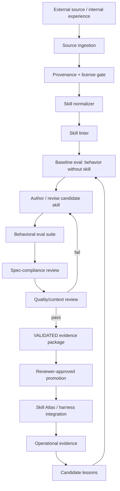

# Ginkgo Agent Foundry — Feature Program v1

Status: **P1/P2 · FEATURE · SPEC-ONLY**

The Agent Foundry is the Ginkgo-native system for turning external patterns, internal experience and repeated agent failures into **tested, provenance-backed, context-efficient agent skills** without collapsing skill behavior into public business capabilities.

It extends the Engineering Agent Skills incubation pack in this branch. It does not replace the P0 capability architecture.

## Boundary

```text
CAPABILITY != SKILL != BINDING != TOOL != ADAPTER != PROVIDER != EXECUTOR
```

Agent Foundry assets are internal agent behavior packages unless an independently defined provider-agnostic business capability requires them.

Canonical runtime business path remains:

```text
Caller
-> CapabilityRequest v1
-> Capability Bus
-> Domain Router
-> skill/version
-> adapter/provider when applicable
-> CapabilityResult v1
```

Operational work remains:

```text
TaskOps
-> Executor Router
-> Human | n8n | Hermes | OpenClaw | Sylvia
```

The Foundry governs **how reusable agent behavior is authored, evaluated, discovered and promoted**. It does not grant provider routing authority, runtime mutation authority or production eligibility.

## Upstream concept map

The program is concept-derived from five pinned public sources. No upstream skill text or code is vendored by this feature pack.

| Source | Pinned commit | Concepts adapted |
|---|---|---|
| `anthropics/skills` | `0a64e398ec6bb34a494f0c347e8ccae53a862f8e` | self-contained `SKILL.md` packages, dynamic loading, metadata-driven discovery, scripts/resources |
| `mattpocock/skills` | `885e2ca4d842d139e9aef4e48d366c63cb1b8013` | model-vs-explicit invocation, context pointers, router skills, progressive disclosure, shared domain language |
| `obra/superpowers` | `b36e0829c6d0140e93cfef2ca599b1b07d4a7797` | design-before-build, TDD for behavior, subagent execution, spec review, quality review, verification-before-completion |
| `affaan-m/ECC` | `d8409a4b0813771235555e32e3d8046a73988bfa` | harness-wide skills, hooks, memory, security scanning, continuous learning, context discipline |
| `ultraworkers/claw-code` | `08106b0c3771ef5b4a5aa176acccd460e88b7325` | external event routing, parallel agent coordination, retry/review loops, chat-directed autonomous repository operations |

License/reuse decisions are owned by the Library provenance registry. Conceptual inspiration is allowed here; code/text reuse requires a path-specific license decision.

## Target architecture



The loop is intentionally asymmetric: production experience may generate a **candidate lesson**, but it cannot directly mutate or promote a production skill.

## Feature families

### P0 foundations

1. **Agent Skills package compatibility**
   - recognize a self-contained directory with `SKILL.md` entrypoint;
   - allow scripts, references, templates and fixtures as declared resources;
   - Ginkgo metadata remains authoritative for lifecycle, evidence, provenance and policy.

2. **Skill manifest + linter**
   - required stable skill ID/version;
   - trigger-only discovery metadata;
   - explicit invocation mode;
   - provenance/license metadata;
   - lifecycle and routing eligibility;
   - permission/side-effect declaration;
   - context budget fields;
   - eval references.

3. **Baseline behavioral evidence**
   - candidate behavior is measured without the skill first when the skill claims to change behavior;
   - the baseline records observable behavior, not hidden reasoning;
   - a missing failing baseline must be explicitly justified for reference/retrieval-only skills.

4. **Validation evidence**
   - every promotion claim is backed by reproducible eval/evidence references;
   - `FEATURE` is never production-routable;
   - promotion cannot outrun the commit containing the tested skill.

### P1 evaluation and context control

1. **Skill Eval Harness**
   - baseline, application, retrieval, pressure, adversarial and regression scenarios;
   - expected observable outputs/actions;
   - deterministic fixtures where possible;
   - evidence captured by immutable refs.

2. **Skill TDD**
   - RED: observe the undesired behavior or retrieval gap;
   - GREEN: minimal skill closes the demonstrated gap;
   - REFACTOR: close loopholes while preserving prior passing evals.

3. **Context-budget scoring**
   - description/pointer tokens are treated as always-loaded cost when model-discoverable;
   - body/reference tokens load only when reached;
   - large references are progressively disclosed behind explicit pointers.

4. **Invocation policy**
   - `model`: the model may discover/invoke the skill from trigger metadata;
   - `explicit`: only an explicit human/orchestrator invocation may load it;
   - router skills reduce human cognitive load without becoming a Domain Router.

5. **Two-stage review**
   - spec-compliance review asks whether the implementation satisfies the skill/eval contract;
   - quality review asks whether the package is clear, minimal, maintainable, safe and context-efficient;
   - independent review contexts are preferred for non-trivial changes.

### P2 learning and autonomous operations

1. **Continuous learning pipeline**
   - operational evidence -> candidate lesson -> deduplication -> proposed skill change -> baseline/eval -> review -> PR;
   - `no_change` is a valid outcome;
   - no silent global prompt/config mutation.

2. **Automatic skill optimization**
   - may propose trigger pruning, reference disclosure, dead instruction removal and eval gaps;
   - may not self-approve or self-promote;
   - every behavior-changing edit re-enters the eval path.

3. **Multi-agent execution**
   - planner decomposes bounded work;
   - executors operate on isolated tasks/workspaces;
   - reviewers independently verify spec and quality;
   - disagreements become explicit findings/rulings, not hidden consensus.

4. **Event routing outside coding context**
   - repository, CI, task and agent lifecycle events are normalized by an event router;
   - notifications/status formatting do not consume the implementation agent's working context unless needed.

5. **Bounded autonomous retries**
   - retry only when the failure class is retryable and the next attempt changes something material;
   - circuit breakers cap repeated loops;
   - destructive/security-sensitive/production actions remain explicit policy gates.

6. **Agent-managed repository mode**
   - human supplies direction through an approved channel;
   - TaskOps records work and state;
   - agent team plans, implements, tests, reviews and may prepare a Draft PR when policy permits;
   - merge, release, deploy, secret rotation, policy mutation and lifecycle promotion remain outside default autonomous authority.

## Candidate feature IDs

This program adds the following Feature/F1 candidates:

```text
engineering.skill.author
engineering.skill.eval
engineering.skill.discovery
engineering.skill.security.scan
engineering.subagent.execute
engineering.learning.promote
engineering.event.route
engineering.repo.autonomous.maintain
```

They compose with the existing branch candidates:

```text
engineering.verification.plan
engineering.pr.audit
engineering.pr.post_audit
engineering.security.audit
engineering.reflect
```

## Invocation and context model

```text
skill index
  -> compact trigger metadata
  -> candidate ranking
  -> load selected SKILL.md
  -> progressively load references/scripts only when needed
```

The Foundry must not load the entire skill corpus into every agent context.

A model-invoked description is a **context pointer**, not a compressed workflow. It should describe when the skill applies; operational steps stay in the skill body so the model does not shortcut the package.

## Skill TDD rule

For behavior-changing skills:

```text
NO PROMOTION WITHOUT BASELINE + GREEN EVIDENCE
```

This is intentionally narrower than claiming every documentation edit must have a failing test. Pure references may use retrieval/application evals; behavior-enforcing skills require an observed baseline gap before promotion.

## Learning safety invariant

```text
EXPERIENCE
-> CANDIDATE LESSON
-> EVAL
-> REVIEW
-> PR
-> PROMOTION DECISION
```

Never:

```text
EXPERIENCE -> DIRECT PRODUCTION SKILL MUTATION
```

Memory, evidence and knowledge remain distinct:

```text
runtime memory != evidence != promoted knowledge != skill contract
```

## Repository placement

```text
ginkgo-agents
  -> skill behavior, feature manifests, eval definitions

ginkgo-library
  -> source provenance, licenses, discovery/index metadata, promotion evidence index

ai-stack
  -> canonical Foundry/runtime/context/promotion contracts and architecture
```

## Promotion gates

A Foundry member may leave `FEATURE` only when all applicable gates are evidenced:

- package/manifest schema valid;
- provenance and license decision recorded;
- baseline or justified reference-only exception recorded;
- behavioral/retrieval/application evals pass;
- pressure/adversarial evals pass when the skill enforces discipline or handles untrusted input;
- mutation/permission boundaries tested;
- context budget reviewed;
- no duplicate/conflicting skill exists without an explicit composition decision;
- reviewer approves promotion;
- tested commit is pinned.

## Non-goals of this feature branch

- installing third-party skills into production harnesses;
- copying third-party skill text/code;
- enabling live provider credentials;
- modifying the frozen `CapabilityRequest v1` or `CapabilityResult v1`;
- creating a second Domain Router or Executor Router;
- automatic production merge/deploy/release;
- direct self-editing production memory/skills;
- declaring any candidate `VALIDATED`, `INTEGRATED` or `PRODUCTION` without Ginkgo-owned evidence.
