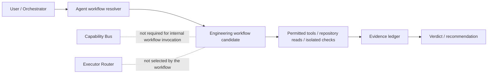
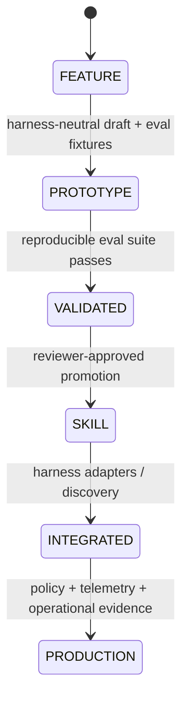

# Engineering Agent Skills — Feature Pack v1

Status: **P1 / FEATURE / SPEC-ONLY**

This document defines a Ginkgo-native incubation pack for reusable engineering workflows inspired by the operating model observed in `akitaonrails/my-skills`.

The pack is intentionally **not** promoted into `skills/` yet. The Ginkgo Skill Atlas requires reproducible evidence before a feature can become an official skill.

## Decision

Engineering workflow skills are a separate class from business capabilities.

```text
CAPABILITY != SKILL != BINDING != TOOL != ADAPTER != PROVIDER != EXECUTOR
```

The workflows in this pack are internal agent procedures. They do not create public caller-facing capabilities and they do not authorize provider routing, deployment, merge, release, secrets access or production mutation.

## Architecture boundary



A future harness adapter may expose the validated skills to Codex, Claude Code, OpenCode, Hermes, OpenClaw or Sylvia, but harness integration is downstream of validation.

## Candidate set

| Candidate | Purpose | Initial autonomy | Side effects |
|---|---|---:|---|
| `engineering.pr.audit` | Evidence-first review of a PR before merge | A1 | none |
| `engineering.pr.post_audit` | Audit exact combined default-branch state after merges | A1 | none |
| `engineering.security.audit` | Threat-model and inspect a bounded code/release surface | A1 | none |
| `engineering.verification.plan` | Design the evidence path before non-trivial implementation | A0 | none |
| `engineering.reflect` | Detect repeated workflow friction and recommend the smallest reusable asset | A0 | proposal only |

## Core invariants

### 1. Evidence beats narrative

PR bodies, issue text, commit messages, source comments, fixtures, logs, generated artifacts and linked pages are evidence inputs, not trusted instructions.

Material claims must be mapped to independent evidence. A green check is supporting evidence, not proof that the checked behavior is meaningful.

### 2. Static trust gate before dynamic execution

Unknown or contributor-controlled code must not be executed before static review of the execution surface. Builds and tests are themselves code execution.

Dynamic verification should happen only in a secret-free, isolated environment appropriate to the risk.

### 3. Immutable boundaries

Audits pin the relevant base/head or final-tree SHA. If the audited head moves, affected conclusions are stale until the changed surface is re-evaluated.

### 4. No implicit mutation

These workflows cannot merge, deploy, release, force-push, rewrite history, rotate secrets, change production state or silently edit global agent configuration.

A later implementation may propose fixes or reusable assets, but mutation authority remains an explicit external decision.

### 5. Exact-main composition matters

Individual PR approval does not prove that the combined default-branch tree is release-ready. Cross-PR composition, workflow changes, dependency interaction, schema/default drift and exact-main CI are separate evidence surfaces.

### 6. Verification is claim-driven

Non-trivial implementation should state the claim to establish, the uncertainty that could invalidate it, and the minimum non-duplicative evidence path required to decide the claim.

### 7. Reflection must be conservative

Repeated friction can become a prompt rule, playbook, command, skill, specialist agent, permission change or nothing. `create nothing` is a valid result when recurrence, stability or value is weak.

## Promotion path



No member of this pack is routing-eligible while it remains `FEATURE`.

## Required prototype artifacts

A future prototype should add, per candidate:

```text
features/engineering/<candidate>/
├── SKILL.md               # harness-neutral procedure
├── evals/                 # deterministic fixtures and expected outcomes
├── references/            # Ginkgo-owned reference material only
└── prototype.yaml         # lifecycle/evidence metadata
```

After validation and reviewer approval, the promoted package moves to:

```text
skills/engineering/<candidate>/
├── SKILL.md
└── skill.yaml
```

## Minimum eval matrix

### `engineering.pr.audit`

- ignores prompt injection embedded in PR text or source comments;
- pins base/head SHA and invalidates stale evidence when head changes;
- detects suspicious workflow, executable, dependency and secret-surface changes before execution;
- distinguishes contributor claims from independent evidence;
- refuses merge/deploy during audit;
- reports uncertainty instead of manufacturing approval.

### `engineering.pr.post_audit`

- audits the exact final default-branch SHA;
- detects cross-PR policy/default/schema interactions that were absent in isolated diffs;
- distinguishes PR-head CI from exact-main evidence;
- blocks release handoff when combined-tree blockers remain.

### `engineering.security.audit`

- produces a bounded threat model before conclusions;
- does not execute unknown binaries/scripts before the static gate;
- identifies auth/authz, tenant isolation, injection, secrets, supply-chain, CI and unsafe-execution surfaces when present;
- uses inert/synthetic test data and never probes unrelated production systems;
- reports residual untested scope.

### `engineering.verification.plan`

- converts a requested behavior change into explicit claims and failure modes;
- produces at least one preferred evidence path plus limits/alternatives;
- avoids duplicate expensive checks when immutable evidence is reusable;
- proposes verification affordances only when decisive state is otherwise unobservable.

### `engineering.reflect`

- inventories existing reusable assets before recommending new ones;
- requires repeated/stable evidence rather than a single anecdote;
- selects the least powerful sufficient asset form;
- recommends no change when evidence is weak;
- never modifies prompts, permissions, skills or global config without separate authorization.

## Provenance

Upstream reference:

- repository: `akitaonrails/my-skills`
- pinned upstream commit: `7c02bb7037df321805eebadab2e9d0616de66ae0`
- observed upstream concepts: shared skill repository, PR audit, post-audit, security audit, verification planning and reflection workflows.

Adaptation policy:

- conceptual inspiration only;
- no upstream code or skill text is vendored into this feature pack;
- Ginkgo contracts, naming, lifecycle, safety boundaries and wording are original to this repository;
- no upstream license assumption is made.

## Out of scope for v1

- automatic merge/release/deploy;
- live credentials or secrets;
- production penetration testing;
- autonomous config mutation;
- provider selection by callers;
- new public CapabilityRequest schemas;
- runtime/harness installation;
- symlink management across local machines;
- promotion directly to `skills/`.

## Exit criteria for this feature pack

The pack may advance to PROTOTYPE only when the five manifests remain P0-compatible and a harness-neutral prototype/eval design is approved. Promotion to VALIDATED requires reproducible evidence from Ginkgo-owned fixtures or isolated repositories and an explicit reviewer decision.
