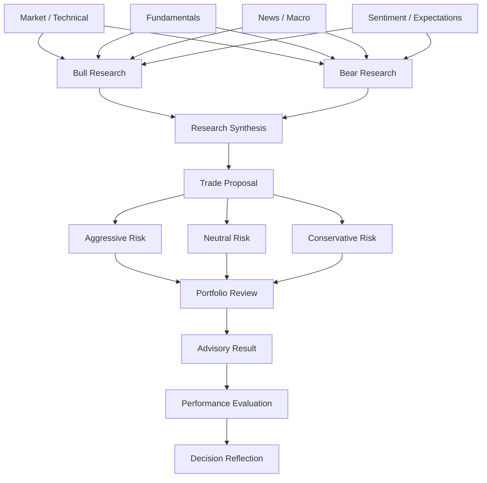

# Finance Intelligence Skill Atlas v1

## Status

Architecture/contracts/evidence scaffold only.

- Runtime activation: **OFF**
- Live broker/exchange calls: **OFF**
- Transaction authority: **NONE**
- Lifecycle ceiling for new finance records in this batch: **FEATURE**
- Canonical core contracts: `Ginkgo-Core/ai-stack`
- Architectural reference: `TauricResearch/TradingAgents` v0.3.1, patterns only

## Canonical boundary

```text
Caller
-> CapabilityRequest v1
-> Capability Bus
-> Finance Domain Router
-> skill/version
-> adapter when applicable
-> provider when applicable
-> CapabilityResult v1
```

Operational execution is separate:

```text
TaskOps
-> Executor Router
-> Human | n8n | Hermes | OpenClaw | Sylvia
```

```text
CAPABILITY != SKILL != BINDING != TOOL != ADAPTER != PROVIDER != EXECUTOR
```

## Finance capability family

### READ

- `finance.instrument.resolve`
- `finance.market.snapshot`
- `finance.company.fundamentals.read`
- `finance.news.collect`
- `finance.sentiment.collect`
- `finance.macro.read`
- `finance.market.expectations.read`

### ANALYZE

- `finance.market.technical.analyze`
- `finance.company.fundamentals.analyze`
- `finance.news.analyze`
- `finance.sentiment.analyze`
- `finance.research.debate`
- `finance.research.synthesize`
- `finance.trade.propose`
- `finance.risk.evaluate`
- `finance.portfolio.review`
- `finance.performance.evaluate`
- `finance.decision.reflect`

### SIMULATE

- `finance.backtest.simulate`

### TRANSACTION — reserved / not registered as routable

- `finance.order.submit`
- `finance.order.cancel`
- `finance.position.close`
- `finance.funds.transfer`

The transaction namespace is intentionally outside the current Skill Atlas activation surface.

## Reference workflow



## TradingAgents mapping

| Upstream concept | Ginkgo semantic target | Notes |
|---|---|---|
| Market Analyst | `finance.market.technical.analyze` | Must consume verified snapshot; no invented prices |
| Fundamentals Analyst | `finance.company.fundamentals.analyze` | Point-in-time-safe inputs required |
| News Analyst | `finance.news.analyze` | Source and release-time provenance required |
| Sentiment Analyst | `finance.sentiment.analyze` | Must consume sourced observations; never fabricate posts |
| Bull/Bear Researchers | `finance.research.debate` | Shared evidence set; explicit counter-thesis |
| Research Manager | `finance.research.synthesize` | Deep-reasoning candidate |
| Trader | `finance.trade.propose` | Advisory only; `execution_allowed=false` |
| Aggressive/Neutral/Conservative risk | `finance.risk.evaluate` | Multi-perspective risk review |
| Portfolio Manager | `finance.portfolio.review` | No order authority |
| Decision log + reflection | `finance.performance.evaluate` + `finance.decision.reflect` | Outcome-based learning |
| Backtrader integration | `finance.backtest.simulate` | Candidate only, no automatic adoption |

## Model routing policy

Recommended internal model split:

```text
quick / low-cost
-> extraction
-> normalization
-> first-pass analysis
-> evidence summarization

deep reasoning
-> adversarial synthesis
-> trade proposal arbitration
-> risk synthesis
-> portfolio review
```

Callers never select provider/model as execution authority. The Domain Router and model-routing policy resolve eligible implementations.

## Temporal integrity

Every time-sensitive evidence record should carry where applicable:

```text
event_time
available_at
observed_at
ingested_at
source_id
provider_id
```

Historical simulations enforce:

```text
available_at <= simulation_time
```

This rule is mandatory because upstream TradingAgents itself has fixed historical look-ahead defects; benchmark-grade Ginkgo simulations must make temporal leakage testable rather than implicit.

## Trade proposal boundary

The domain-level proposal shape is advisory:

```yaml
instrument: required
action: BUY | HOLD | SELL | REDUCE | INCREASE
confidence: 0..1
time_horizon: required
thesis: required
bull_case: required
bear_case: required
risk_score: 0..1
suggested_position_pct: optional
stop_conditions: []
evidence: []
model_evidence: []
generated_at: required
execution_allowed: false
```

`execution_allowed` cannot be caller-overridden.

## Deterministic policy ownership

LLMs must not own or weaken:

- asset allowlists;
- account/broker allowlists;
- max position percentage;
- max notional exposure;
- leverage ceiling;
- daily-loss/drawdown stops;
- market-hours rules;
- freshness thresholds;
- transaction enablement;
- Approval requirements;
- External Gates;
- kill switch.

## Evidence loop

```text
proposal
-> expected outcome
-> realized outcome
-> benchmark-relative outcome
-> forecast error
-> reflection
-> future context
```

Evaluation metadata should include model/provider/version and token/API cost so the system can answer not only “did the idea work?” but “which analyst/model produced useful alpha per unit cost?”

## Promotion gates

No finance feature moves beyond `FEATURE` in this PR.

Promotion requires at minimum:

1. exact input/output contract;
2. permission/action classification;
3. deterministic instrument identity;
4. temporal provenance validation;
5. stale-data tests;
6. no-look-ahead tests;
7. normalized errors/retries;
8. provider/model provenance;
9. reproducible fixtures;
10. eval pack;
11. secret scan;
12. reviewer approval.

## Transaction-domain gate

A future transaction capability requires a separate architecture and evidence train:

```text
Finance Intelligence
-> TradeProposal
-> deterministic Risk Policy
-> Approval
-> Transaction Domain
-> Broker Adapter
-> Execution
-> Reconciliation
-> immutable Evidence
```

Mandatory prerequisites before any live canary:

- broker adapter contract;
- account/identity binding;
- scoped secrets boundary;
- idempotency;
- order-state reconciliation;
- partial-fill handling;
- position reconciliation;
- bounded exposure limits;
- kill switch;
- paper-trading validation;
- explicit approval for bounded live canary.

## Non-goals

- no broker credential storage;
- no exchange keys;
- no order submission;
- no fund transfers;
- no copy trading;
- no strategy-profitability claim;
- no upstream benchmark treated as Ginkgo validation.