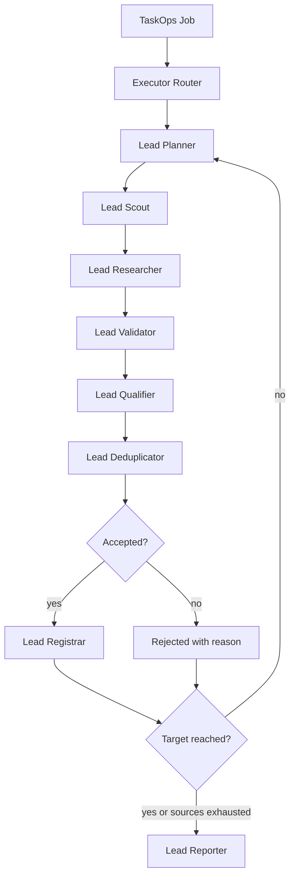

# Lead Intelligence Agent Loadout v1

Status: `FEATURE / F1`

This document defines the Ginkgo-native agent composition for recurring B2B lead intelligence. It replaces dependence on a monolithic external operator such as Manus while preserving the frozen boundary:

```text
Caller
-> CapabilityRequest v1
-> Capability Bus
-> Sales Domain Router
-> skill/version
-> adapter/provider
-> CapabilityResult v1
```

Execution remains separate:

```text
TaskOps
-> Executor Router
-> n8n | Hermes | OpenClaw | Sylvia | future executor
```

The executor is an implementation detail. No executor receives a master key to all sources, CRM systems or communication channels.

## 1. Outcome

Build a target quantity of **accepted leads**, not a target quantity of raw rows.

```text
ICP + geography + target accepted quantity
-> query/coverage plan
-> discovery
-> normalization
-> enrichment
-> contact/evidence validation
-> qualification
-> deduplication
-> governed CRM persistence
-> report
```

The default reference operation is 200 accepted leads per daily run. Scheduling belongs to TaskOps, not to the skill.

## 2. Agent roles

### Lead Planner

Purpose:
- expand ICP + geography into a bounded query matrix;
- estimate expected yield and query budget;
- diversify categories/cities when yield falls;
- stop when target is reached or policy-eligible coverage is exhausted.

Authority: analysis only.

Must not:
- choose providers;
- request proxies or anti-bot bypass;
- authorize outreach;
- mutate CRM.

### Lead Scout

Purpose:
- execute `sales.lead.discover` through the Sales Domain Router;
- collect candidate organizations from policy-eligible sources;
- attach source IDs/URLs and timestamps.

Authority: READ.

### Lead Researcher

Purpose:
- execute `sales.lead.enrich`;
- collect business website/domain/category/location/contact/reputation/operational signals where permitted;
- label `OBSERVED`, `INFERRED` and `MISSING` fields distinctly.

Authority: READ.

### Lead Validator

Purpose:
- execute `sales.lead.validate`;
- normalize and validate phone/contact evidence;
- preserve `VALID`, `INVALID`, `UNKNOWN`, `NOT_CHECKED` states;
- verify source provenance and freshness.

Authority: READ + analysis.

Hard rule:

```text
phone_available != whatsapp_valid
```

Opening a `wa.me` page is not conclusive evidence. The validator must not send a WhatsApp message, call the number or otherwise contact the lead to test channel availability.

### Lead Qualifier

Purpose:
- execute `sales.lead.qualify`;
- apply the versioned ICP;
- return score, band, factors, evidence refs and uncertainty.

Default scoring:

| Dimension | Weight |
|---|---:|
| Commercial fit | 30 |
| Digital presence | 15 |
| Operational-volume signal | 20 |
| Automation opportunity | 25 |
| Data quality | 10 |

Bands:
- `HOT`: 80–100
- `GOOD`: 60–79
- `MEDIUM`: 40–59
- `LOW`: 0–39

Default accepted bands: `HOT`, `GOOD`.

### Lead Deduplicator

Purpose:
- execute `sales.lead.deduplicate`;
- merge duplicates without losing provenance;
- preserve the best-known values and all source evidence.

Priority keys:
1. stable source/provider ID;
2. normalized phone;
3. normalized domain;
4. canonical website;
5. normalized organization name + city.

Authority: local transformation only.

### Lead Registrar

Purpose:
- persist accepted records through `sales.pipeline.record`;
- update an existing canonical record instead of creating a duplicate;
- require idempotency.

Authority: governed MODIFY.

Required record fields include:
- first_seen_at;
- last_validated_at;
- source/evidence refs;
- phone status;
- WhatsApp status;
- qualification score/band;
- rejection/acceptance reason;
- idempotency key.

### Lead Reporter

Purpose:
- execute `sales.lead.report.generate`;
- produce a reconciled funnel and quality report;
- flag capability limitations rather than inventing data.

Required funnel metrics:
- queries_executed;
- raw_results;
- unique_businesses;
- phones_found;
- phones_valid;
- whatsapp_valid;
- whatsapp_unknown;
- whatsapp_invalid;
- qualified_hot;
- qualified_good;
- qualified_medium;
- duplicates_removed;
- crm_saved;
- rejected.

## 3. Orchestration pattern



The Planner may fan out independent discovery/enrichment batches, but the final deduplication and acceptance counters must reconcile on canonical state.

## 4. Provider strategy

The public capability never names a provider.

### Preferred candidate: Firecrawl adapter

Role:
- broad web search;
- structured extraction;
- business-site enrichment;
- directory extraction;
- evidence URLs.

Why it fits:
- exposes search/scrape/extract primitives suitable for agents;
- publishes outcome-oriented lead-generation workflows;
- supports common agent harnesses including Hermes/OpenClaw through its CLI/skills ecosystem.

Status: candidate only until adapter, cost, provenance, licensing and E2E gates pass.

### Legacy candidate: Ledger Lead Finder

Role:
- optional adapter if its contract, data provenance, terms and quality can be verified.

It must not own:
- the public sales capability;
- the ICP;
- deduplication truth;
- WhatsApp truth;
- CRM authority;
- scheduling;
- outreach authority.

### Lab-only candidate: gosom/google-maps-scraper

Technically attractive because it is self-hostable, REST/CLI capable and returns rich business fields. However, its target-source terms posture is a separate risk from its MIT software license. It remains lab-only until explicit terms/legal review authorizes the intended use.

## 5. Source and privacy policy

Default posture:
- business entities only;
- public or licensed business data only;
- no private-individual targeting;
- explicit provenance per material field;
- source terms/license decision before routing;
- retention/deletion policy required;
- no anti-bot or rate-limit bypass;
- no provider-specific hacks in caller input.

If a source cannot legally or contractually support storage/use for lead intelligence, the correct output is `SOURCE_POLICY_BLOCKED`, not a workaround.

## 6. Risk classes

### READ
Discovery, enrichment, evidence validation.

Allowed only after source-policy checks.

### MODIFY
CRM persistence/update.

Requires idempotency, provenance and governed write authority.

### COMMUNICATE
WhatsApp, e-mail, call, form submission, LinkedIn message.

Denied by this pack. Outreach is a separate capability family.

### TRANSACTION
Paid data purchase, credit consumption above policy, checkout/payment.

Denied unless a distinct transactional capability and budget policy authorizes it.

## 7. Accepted-lead invariant

```text
accepted_lead =
  unique_business
  AND source_policy_eligible
  AND qualification_band_allowed
  AND required_contact_evidence_satisfied
```

Therefore:

```text
200 raw results != 200 accepted leads
```

The loop continues until the requested accepted quantity is reached or the policy-eligible source/query budget is exhausted.

## 8. Reference migration from the Manus prototype

Observed prototype behavior:
- scheduled daily collection;
- 200-lead target;
- Google Places discovery;
- phone observed;
- WhatsApp status uncertain;
- no outreach initiated.

Migration rule:

```text
Manus session / Lead Ledger Finder workflow
-> TaskOps recurring job
-> Ginkgo agent loadout
-> provider-neutral Sales capabilities
-> router-selected source adapters
-> evidence + CRM + report
```

No Manus browser session is part of the target architecture.

## 9. Promotion path

```text
F1 SPECIFIED
-> F2 PROTOTYPE
-> F3 VALIDATED
-> S1 SKILL
-> S2 INTEGRATED
-> S3 PRODUCTION
```

Promotion requires at minimum:
- typed lead contracts;
- source/provenance registry;
- provider-neutral adapter tests;
- fixture-based validation/dedup/qualification tests;
- source-policy negative tests;
- governed read-only E2E;
- governed idempotent CRM write E2E;
- cost/rate observability;
- reviewer approval.

Until then, this is a Skill Family candidate, not a production-capable skill.
