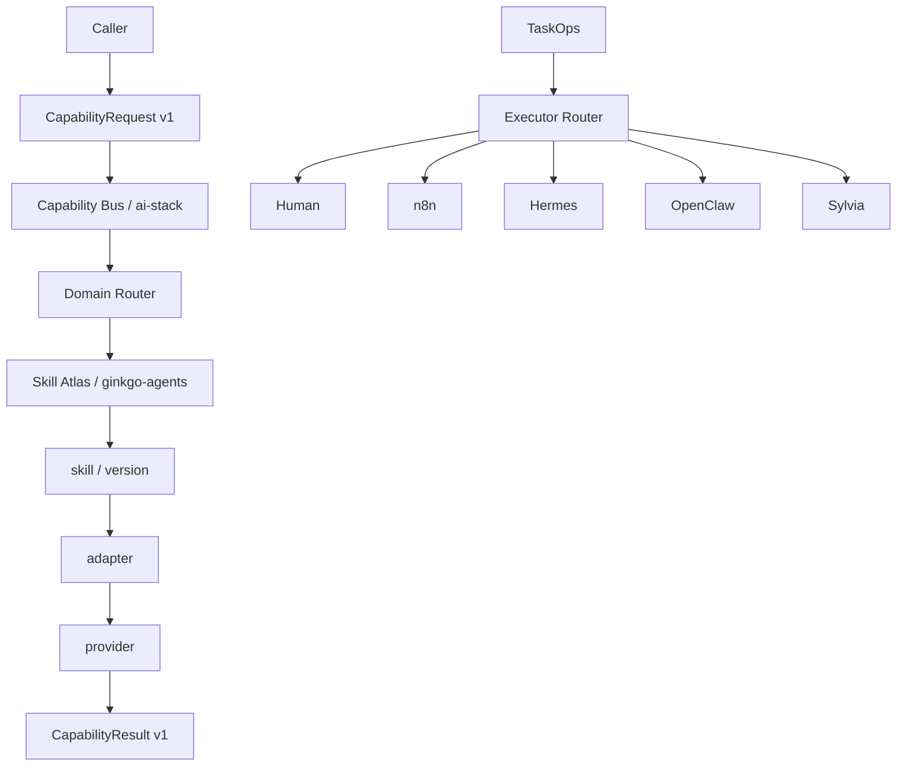

# Ginkgo Agents

Laboratório operacional da Ginkgo AI Systems para **agentes especializados, skills reutilizáveis, evals, contratos e automações agentic-ready**.

Este repositório mantém o Skill Atlas e descreve **como uma capability provider-agnostic é implementada, validada e promovida como skill/binding confiável**. Os contratos core e a arquitetura P0 são definidos em `Ginkgo-Core/ai-stack`.

## Alinhamento P0

O Draft PR de Commerce está alinhado ao P0 Architecture Freeze de `Ginkgo-Core/ai-stack#15` e à convergência arquitetural adotada em `Ginkgo-Core/ai-stack#9`.

Boundary universal:

```text
Caller
-> CapabilityRequest v1
-> Capability Bus
-> Domain Router
-> skill/version
-> adapter
-> provider
-> CapabilityResult v1
```

Execução operacional é separada:

```text
TaskOps
-> Executor Router
-> Human | n8n | Hermes | OpenClaw | Sylvia
```

`Domain Router != Executor Router`.

Callers expressam `capability.name` e `capability.contract_version`. Eles não escolhem `skill_id`, `skill_version`, adapter, provider, endpoint, credential ou secret. O Domain Router resolve a implementação elegível.

## Contratos canônicos

O Agents **não duplica** os JSON Schemas P0. Referências canônicas:

- `Ginkgo-Core/ai-stack/contracts/core/capability-request.schema.json` — CapabilityRequest v1
- `Ginkgo-Core/ai-stack/contracts/core/capability-result.schema.json` — CapabilityResult v1
- `Ginkgo-Core/ai-stack/contracts/core/approval.schema.json`
- `Ginkgo-Core/ai-stack/contracts/core/external-gate.schema.json`
- `Ginkgo-Core/ai-stack/contracts/core/evidence.schema.json`

Os envelopes históricos `ginkgo.skill-request.v1` e `ginkgo.skill-result.v1`, quando encontrados, são somente aliases/adapters de compatibilidade legacy. Não são source of truth para novas integrações.

## Papel no ecossistema



- **ai-stack:** arquitetura P0, Capability Bus, contratos core, routing boundaries e runtimes compartilhados.
- **Ginkgo Agents:** Skill Atlas, manifests, evals, implementation bindings, loadouts e promotion evidence.
- **TaskOps / Executor Router:** seleção de executor operacional.
- **n8n / Hermes / OpenClaw / Sylvia / Human:** executores/callers; não são autoridade para seleção de provider.
- **Adapters/providers:** implementação interna atrás do Domain Router.

## Regra central

```text
FEATURE != PRODUCTION
```

Lifecycle canônico:

```text
FEATURE
-> PROTOTYPE
-> VALIDATED
-> INTEGRATED
-> PRODUCTION
```

Os códigos históricos `F0/F1/F2/F3/S1/S2/S3` e marcadores `SPECIFIED`/`SKILL` continuam como metadata de compatibilidade. Eles não criam novos estados caller-facing.

Nada sai de `FEATURE` sem evidência reproduzível, e `FEATURE` nunca executa em produção.

## Naming

Capabilities públicas são provider-agnostic:

```text
commerce.catalog.search
commerce.catalog.read
commerce.pricing.read
commerce.inventory.read
commerce.orders.read
commerce.product.normalize
commerce.product.evaluate
```

Provider-specific IDs representam **bindings/skills internos**, não capabilities públicas:

```text
amazon-spapi.catalog.search
amazon-spapi.pricing.read
amazon-spapi.inventory.read
amazon-spapi.orders.read

shopee-open-api.catalog.read
shopee-open-api.orders.read
shopee-open-api.product.normalize
```

`commerce.product.evaluate` permanece provider-neutral por ser lógica determinística de domínio.

Os antigos IDs `commerce.amazon.*` e `commerce.shopee.*` são preservados somente como aliases deprecated nos manifests atuais para evitar quebra silenciosa do Atlas.

## Governance P0

- Approval states: `NOT_REQUIRED | PENDING | APPROVED | REJECTED | EXPIRED`.
- External Gate states: `CLEAR | BLOCKED | UNKNOWN | EXPIRED`.
- Approval e External Gate são contratos independentes.
- fallback default: `none`.
- único fallback genérico permitido: `same_semantics_only`.
- sem fallback silencioso Amazon <-> Shopee, read -> write, cross-domain ou `FEATURE` -> production.
- Evidence != Knowledge.
- GitHub é source of truth para contratos, manifests e promotion evidence.

## Commerce ceilings atuais

- Amazon bindings: `FEATURE`.
- Shopee bindings: `FEATURE / PRE_APPROVAL`.
- `commerce.product.evaluate`: `PROTOTYPE / F2`.

A evidência Shopee atual é `Scale-Characters/amazon-ops#2`, head `bccfc0f5142f432f889158870c8f9e26e353fa65`: Ruff PASS, 28 testes Shopee offline, 104 testes gerais passados + 1 deselected, diagnóstico Windows/Linux conhecido e non-blocking, mutations OFF e live Shopee OFF. Offline CI não prova live-provider validation.

## Manuais canônicos

Leia primeiro:

- [`SKILL_ATLAS.md`](./SKILL_ATLAS.md) — níveis, maturidade detalhada, promotion gates, manifests, evals, loadouts e governance.
- [`SKILL_RUNTIME_CONTRACT.md`](./SKILL_RUNTIME_CONTRACT.md) — referência do Agents ao CapabilityRequest/CapabilityResult P0, routing split, Approval, External Gates, fallback e evidence semantics.
