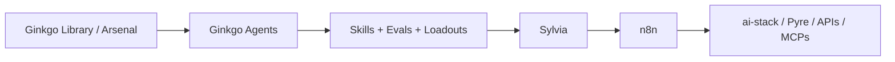

# Ginkgo Agents

Laboratório operacional da Ginkgo AI Systems para **agentes especializados, skills reutilizáveis, evals, contratos e automações agentic-ready**.

Este repositório é a camada canônica de **como uma capability vira uma skill confiável para agentes**. Ele é separado dos produtos comerciais e dos runtimes de execução.

## Papel no ecossistema



- **Ginkgo Library / Arsenal:** o que existe — capabilities, providers, tools, endpoints e policies.
- **Ginkgo Agents:** como usar — skills, manifests, evals, loadouts e promotion gates.
- **Sylvia:** quando usar — seleção de capability/skill.
- **n8n:** execução/orquestração de workflows.
- **ai-stack:** runtimes locais compartilhados.
- **Pyre:** creative routing/provider abstraction.

## Regra central

```text
FEATURE != SKILL
```

Uma feature permanece incubada até ser validada com evidência reproduzível. Só então pode ser promovida para o catálogo operacional de skills.

Fluxo canônico:

```text
FEATURE
→ SPECIFIED
→ PROTOTYPE
→ VALIDATED
→ SKILL
→ INTEGRATED
→ PRODUCTION
```

## Manual canônico

Leia primeiro:

- [`SKILL_ATLAS.md`](./SKILL_ATLAS.md) — níveis de skills e agentes, lifecycle, promotion gates, uso de n8n/ComfyUI, manifests, evals, loadouts e governance.

## Princípio de naming

Skills são nomeadas por **propósito**, não por vendor ou ferramenta.

Bom:

- `media.image.generate.local`
- `commerce.product.create-ad`
- `sales.lead.qualify-and-book`
- `code.repo.inspect`

Evitar:

- `skill-comfyui`
- `skill-gemini`
- `skill-n8n`

Ferramentas/providers são implementações substituíveis por trás de contratos estáveis.
