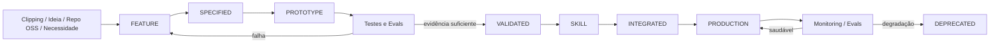
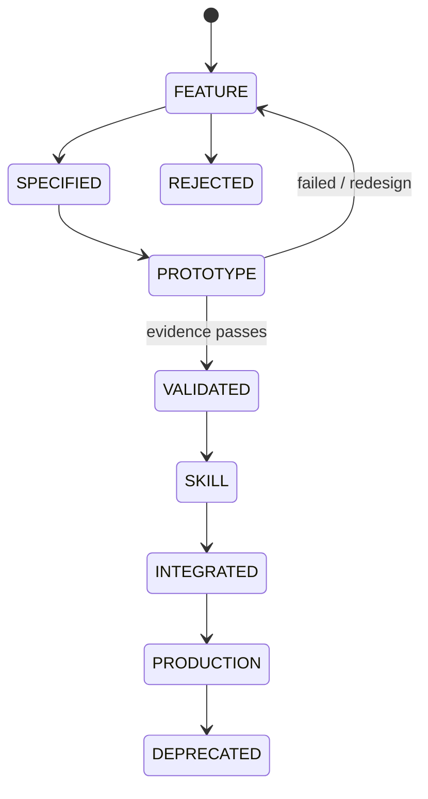
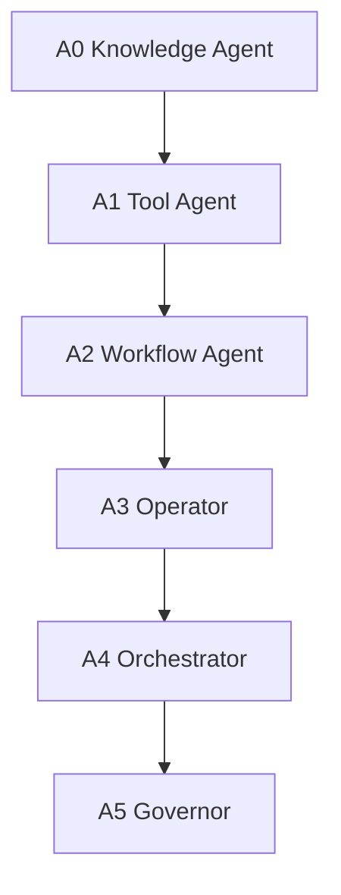
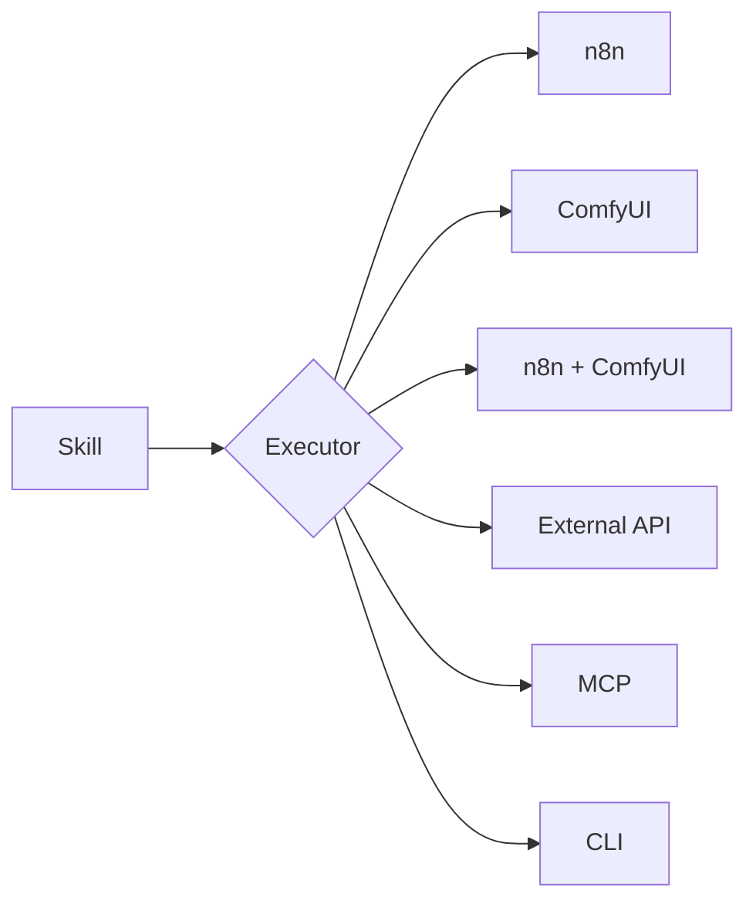
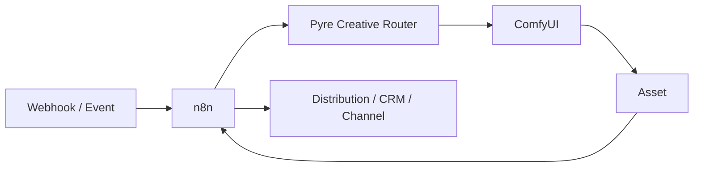
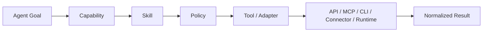
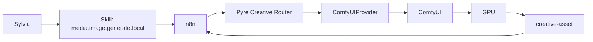
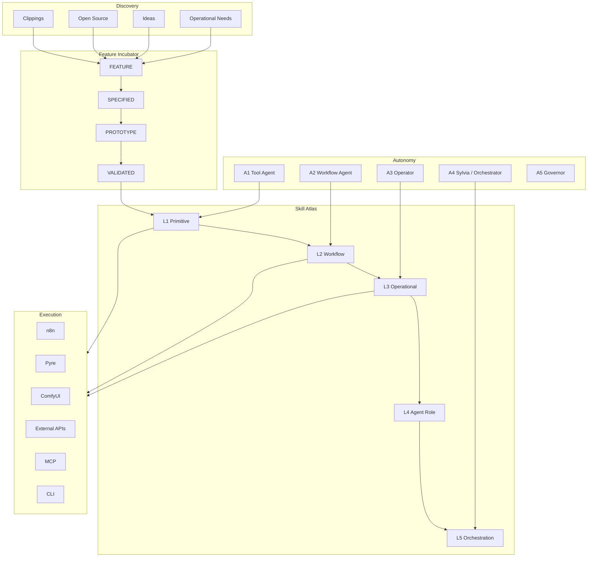

# Ginkgo Skill Atlas

> Manual canônico de capacidades agentic-ready da Ginkgo AI Systems.
>
> **Regra central:** `FEATURE != SKILL`.
>
> Uma feature é uma hipótese, referência, clipping, workflow experimental ou capacidade candidata. Uma skill só existe oficialmente quando foi validada com evidência reproduzível, contrato claro, owner, permissões, runtime e resultado normalizado.

---

## 1. Objetivo

O Skill Atlas organiza tudo que agentes da Ginkgo podem vir a executar — via n8n, ComfyUI, API, MCP, CLI, connector ou runtime local — sem contaminar o catálogo operacional com ideias ainda não comprovadas.

O Atlas responde cinco perguntas:

1. **O que o agente sabe fazer?**
2. **Com qual nível de autonomia?**
3. **Por qual executor/runtime?**
4. **Em qual estágio de maturidade?**
5. **Qual evidência autoriza a promoção de feature para skill?**

O objetivo não é catalogar ferramentas por marca. O objetivo é modelar **ações reutilizáveis por propósito**.

Exemplos corretos:

- `media.image.generate.local`
- `commerce.product.create-ad`
- `sales.lead.qualify-and-book`
- `knowledge.clipping.ingest`
- `code.repo.inspect`

Exemplos incorretos:

- `skill-comfyui`
- `skill-gemini`
- `skill-n8n`
- `skill-supabase`

Ferramentas e providers são implementações substituíveis sob contratos estáveis.

---

## 2. Arquitetura conceitual



Nenhuma feature sai da incubadora apenas porque:

- parece útil;
- existe um projeto open source interessante;
- funcionou manualmente uma vez;
- um provider diz suportar a função;
- um clipping descreve um caso de uso;
- um workflow foi importado sem teste real.

A promoção exige evidência.

---

## 3. Dois eixos independentes

O Atlas separa **maturidade da skill** de **autonomia do agente**.

### 3.1 Maturidade

| Código | Estado | Significado |
|---|---|---|
| `F0` | FEATURE | ideia, clipping, referência ou capacidade candidata |
| `F1` | SPECIFIED | propósito, contrato, owner e riscos descritos |
| `F2` | PROTOTYPE | existe implementação experimental |
| `F3` | VALIDATED | E2E e critérios mínimos aprovados |
| `S1` | SKILL | skill oficial com manifest e evidência |
| `S2` | INTEGRATED | integrada ao ecossistema agentic |
| `S3` | PRODUCTION | uso operacional com observabilidade e política |
| `SX` | DEPRECATED | retirada do catálogo ativo |
| `RX` | REJECTED | hipótese descartada com motivo registrado |

### 3.2 Autonomia

| Nível | Papel | Autorização típica |
|---|---|---|
| `A0` | Knowledge | ler, classificar, resumir, recomendar |
| `A1` | Tool User | executar primitive de baixo risco |
| `A2` | Workflow Operator | disparar workflows validados |
| `A3` | Autonomous Executor | executar processo operacional completo dentro de política |
| `A4` | Orchestrator | selecionar capacidades, skills e executores |
| `A5` | Governor | alterar routing, budgets, políticas e promoção/depreciação |

**Importante:** uma skill pode estar em `S3/PRODUCTION` e ainda assim exigir `A1` ou aprovação humana. Maturidade não implica autonomia irrestrita.

---

## 4. Lifecycle oficial



### FEATURE

Pode conter:

- clipping;
- GitHub externo;
- paper;
- vídeo/transcrição;
- ideia arquitetural;
- workflow conceitual;
- prova manual;
- README de referência;
- pesquisa de provider;
- hipótese comercial.

**Não pode ser tratada por agentes como capacidade oficial.**

### SPECIFIED

A feature já deve possuir, no mínimo:

```yaml
id: media.image.remove-background
purpose: remover o fundo de uma imagem
inputs:
  - image
outputs:
  - transparent_png
candidate_executors:
  - comfyui
  - external_api
owner: pyre
cost_boundary: unknown
risks:
  - malformed_input
  - quality_variance
```

### PROTOTYPE

Existe implementação experimental, por exemplo:

- workflow n8n;
- workflow ComfyUI;
- adapter API;
- MCP;
- CLI;
- script;
- container;
- endpoint interno.

Ela continua em `features/` até a validação completa.

### VALIDATED

Só pode receber `F3/VALIDATED` quando houver evidência de que:

- funciona ponta a ponta;
- input e output estão definidos;
- execução é reproduzível;
- erros principais são conhecidos;
- timeout/retry foram considerados;
- secrets e permissões estão governados;
- owner está definido;
- runtime está definido;
- custo/billing boundary é conhecido ou explicitamente `unknown`;
- teardown é seguro;
- observabilidade mínima existe;
- testes/evals passam;
- existe pelo menos um E2E real quando aplicável;
- evidência está registrada em relatório, commit, PR ou eval.

Só então a promoção para `SKILL` é permitida.

---

## 5. Regra de promoção

```text
FEATURE
→ SPECIFIED
→ PROTOTYPE
→ VALIDATED
→ SKILL
→ INTEGRATED
→ PRODUCTION
```

A decisão deve ser explícita:

```yaml
promotion:
  approved: true
  from: feature
  to: skill
  evidence:
    - WAVE8_REPORT.md
    - e2e: true
    - tests: 12/12
  reviewer: required
```

### Regra principal

> **Nada sai de `features/` sem `VALIDATED = TRUE`.**

E:

> **`VALIDATED` não significa automaticamente `PRODUCTION`.**

A skill recém-promovida entra em `S1/SKILL`. Ela só chega a produção depois de integração e governança operacional.

---

## 6. Níveis funcionais de Skills

### L1 — Primitive

Ação pequena, composável e de responsabilidade única.

Exemplos:

- `media.image.generate.local`
- `storage.file.archive`
- `database.query.read`
- `code.repo.inspect`
- `communication.message.send`
- `audio.transcribe`

Normalmente executada por:

- API;
- MCP;
- CLI;
- ComfyUI;
- connector;
- serviço interno.

### L2 — Workflow

Combina múltiplas primitives em um fluxo reproduzível.

Exemplo:

```text
produto URL
→ extrair dados
→ gerar ângulo comercial
→ gerar imagem
→ gerar copy
→ montar CTA
```

Skill candidata:

`commerce.product.create-ad`

Executor típico: **n8n**.

### L3 — Operational

Resolve um processo empresarial completo.

Exemplo:

```text
lead chegou
→ enriquecer
→ qualificar
→ responder
→ atualizar CRM
→ agendar
→ registrar resultado
```

Skill candidata:

`sales.lead.qualify-and-book`

### L4 — Agent Role

Conjunto de skills que forma um trabalhador especializado.

Exemplo:

```text
Social Media Agent
├── research.trends
├── content.plan
├── media.image.generate
├── media.video.generate
├── copy.write
├── social.publish
└── analytics.review
```

O agente é um **loadout governado de skills**, não um prompt monolítico.

### L5 — Orchestration

Coordena agentes, capabilities e workflows.

Exemplo:

```text
Goal
↓
Capability
↓
Skill
↓
Executor
↓
Evidence
```

Owner típico: **Sylvia / Source**.

---

## 7. Tipos de agentes



### A0 — Knowledge Agent

Pode:

- ler;
- pesquisar;
- classificar;
- resumir;
- comparar;
- recomendar.

Não altera sistemas externos por padrão.

### A1 — Tool Agent

Pode executar primitives de baixo risco e contrato restrito.

Exemplos:

- read APIs;
- generate media;
- query read-only;
- inspect repository;
- lookup metadata.

### A2 — Workflow Agent

Pode acionar workflows já validados.

Exemplo:

```text
Sylvia
→ execute skill media.image.generate.local
→ n8n workflow creative-image-local-v1
```

O agente não improvisa infraestrutura nem shell arbitrário.

### A3 — Operator

Pode executar processos completos sob políticas definidas.

Exemplo:

```text
brief
→ pesquisa
→ criação
→ aprovação
→ publicação
→ métricas
```

### A4 — Orchestrator

Seleciona capability, skill, executor e fallback.

Exemplo: Sylvia.

Ela deve decidir **o que usar**, mas não precisa conhecer detalhes internos de ComfyUI, provider IDs, node IDs ou topologia Docker.

### A5 — Governor

Pode alterar:

- políticas;
- routing;
- budgets;
- permissões;
- promotion/deprecation;
- allowlists.

Inicialmente esse nível deve permanecer sob **humano + reviewer agent**.

---

## 8. Executors: n8n, ComfyUI ou ambos

Skills não são classificadas pela ferramenta. Elas são classificadas pelo propósito.



### Quando priorizar n8n

Use n8n quando a capacidade depende principalmente de:

- webhooks;
- APIs;
- CRM;
- mensageria;
- agenda;
- ETL;
- integrações;
- filas;
- aprovações;
- polling;
- retries;
- sequenciamento de etapas.

### Quando priorizar ComfyUI

Use ComfyUI quando a capacidade depende principalmente de:

- geração de imagem;
- edição de imagem;
- upscale;
- ControlNet;
- LoRA;
- face/identity workflows;
- vídeo generativo;
- pipelines multimodais reproduzíveis.

### Quando usar n8n + ComfyUI

É o padrão para skills que misturam operação e mídia.



Exemplo:

```text
produto
→ n8n
→ Pyre
→ ComfyUI
→ asset
→ n8n
→ copy + link
→ canal de distribuição
```

---

## 9. Taxonomia de Skills

Estrutura recomendada:

```text
skills/
├── research/
├── knowledge/
├── communication/
├── sales/
├── crm/
├── commerce/
├── finance/
├── media/
│   ├── image/
│   ├── video/
│   ├── audio/
│   ├── voice/
│   └── identity/
├── marketing/
├── social/
├── ads/
├── code/
├── devops/
├── security/
├── data/
├── storage/
├── productivity/
├── learning/
├── operations/
└── agents/
```

IDs seguem o padrão:

```text
<domain>.<object>.<action>[.<variant>]
```

Exemplos:

- `media.image.generate.local`
- `media.image.edit`
- `media.image.upscale`
- `media.video.generate`
- `media.video.repurpose`
- `knowledge.clipping.ingest`
- `learning.notebook.build`
- `commerce.product.research`
- `commerce.product.create-ad`
- `sales.lead.qualify`
- `code.repo.review`

---

## 10. Feature Registry

Features continuam no domínio onde nasceram até validação.

Manifest mínimo:

```yaml
id: media.video.live-avatar
status: feature
maturity: F1
purpose: >
  Criar avatar em tempo real para transmissões autorizadas.
candidate_executors:
  - comfyui
  - obs
  - external-provider
validation:
  e2e: false
promotion:
  allowed: false
owner_domain: media
```

Após validação:

```yaml
id: media.video.live-avatar
status: validated
maturity: F3
validation:
  e2e: true
  report: WAVE14_REPORT.md
promotion:
  allowed: true
```

Apenas depois deve existir um skill manifest oficial.

---

## 11. Skill Manifest

Toda skill oficial deve declarar um contrato machine-readable equivalente a:

```yaml
id: media.image.generate.local
version: 1.0.0
level: L1
maturity: S1
autonomy: A2

purpose: >
  Gerar uma imagem local reproduzível através da infraestrutura criativa Ginkgo.

capability: creative.image.local

use_when:
  - privacy_required
  - reproducible_workflow_required
  - local_execution_preferred

avoid_when:
  - local_gpu_unavailable
  - latency_requirement_requires_cloud

inputs:
  required:
    - prompt
  optional:
    - negative_prompt
    - width
    - height
    - seed
    - preset

outputs:
  contract: creative-asset

executor:
  type: n8n
  workflow: creative-image-local-v1
  router: pyre
  runtime: comfyui-local

permissions:
  network: internal
  filesystem_write: assets_only
  shell: false
  external_side_effects: false

cost:
  billing_usd: 0
  compute_cost_estimate: null

fallbacks:
  policy: explicit

validation:
  e2e: true
  evidence:
    - WAVE8_REPORT.md

status: skill
```

---

## 12. Skill Card para humanos e agentes

Além do manifest, cada skill deve ter uma ficha curta.

```text
SKILL
media.image.generate.local

PURPOSE
Gerar imagens localmente com execução reproduzível.

WHEN TO USE
- privacidade
- custo de API indesejado
- controle de workflow

DON'T USE
- GPU indisponível
- necessidade de latência cloud

INPUT
prompt, negative_prompt?, resolution?, seed?

OUTPUT
creative-asset

EXECUTION
n8n → Pyre → ComfyUI

AUTONOMY
A2

RISK
LOW

STATUS
VALIDATED / SKILL

EVIDENCE
Wave 8 E2E
```

A ficha deve permitir que Sylvia ou outro agente entenda rapidamente **quando usar, quando evitar e qual contrato esperar**.

---

## 13. Validation Gate

Toda Skill Validation Wave deve avaliar, quando aplicável:

```text
01 contract test
02 happy path
03 invalid input
04 error normalization
05 timeout
06 retry policy
07 permissions
08 secret scan
09 resource consumption
10 teardown
11 idempotency
12 observability
13 persistence/restart behavior
14 E2E
15 evidence registration
```

Critério final:

```yaml
PROMOTION_APPROVED: true
```

Sem isso, permanece feature.

---

## 14. Evidence Contract

A promoção precisa referenciar evidência verificável.

Aceitável:

- Wave report versionado ou preservado;
- test suite;
- eval results;
- PR com implementação;
- E2E real;
- benchmark;
- security review;
- provider/API validation.

Exemplo:

```yaml
evidence:
  e2e: true
  tests:
    passed: 12
    total: 12
  report: WAVE8_REPORT.md
  implementation_pr: Ginkgo-Core/ai-stack#12
  runtime: comfyui
  validated_at: 2026-08-18
```

---

## 15. Provenance: não apagar a feature promovida

A origem deve permanecer rastreável.

Exemplo:

```text
features/archive/
└── media.image.generate.local/
    └── PROMOTED.md
```

Conteúdo mínimo:

```yaml
promoted_to: media.image.generate.local
version: 1.0.0
status: promoted
evidence:
  - WAVE8_REPORT.md
promoted_at: 2026-08-18
```

Assim preservamos o histórico de como uma hipótese virou capacidade operacional.

---

## 16. Skill Loadouts por agente

Agentes não devem receber todas as skills existentes por padrão.

Cada agente recebe um **loadout mínimo por função**.

Exemplo:

```yaml
agent: social-media-operator
autonomy: A3
skills:
  - research.trends
  - content.plan
  - media.image.generate
  - media.video.generate
  - copy.write
  - social.publish
  - analytics.review
```

Outro:

```yaml
agent: repository-reviewer
autonomy: A2
skills:
  - code.repo.inspect
  - code.diff.review
  - code.tests.read
  - code.issue.create
permissions:
  merge: false
  delete: false
```

Princípio:

> **Least capability:** cada agente recebe apenas as skills necessárias para seu propósito.

---

## 17. Routing e Arsenal

O Skill Atlas não substitui o Ginkgo Arsenal.

A relação é:



Responsabilidades:

- **Ginkgo Library / Arsenal:** o que existe, providers, tools, capabilities, policies;
- **Ginkgo Agents / Skill Atlas:** skills confiáveis, manifests, loadouts, evals e promotion gates;
- **Ginkgo Connect:** connectors/adapters governados;
- **ai-stack:** runtimes locais e workflows validados;
- **Pyre:** creative routing/provider abstraction;
- **Sylvia:** seleção de capability/skill;
- **n8n:** execução/orquestração;
- **Source:** composição de soluções.

---

## 18. Distribuição entre repositórios

```text
Ginkgo-Core/ginkgo-library
├── Arsenal
├── capabilities
├── providers
├── tools
├── endpoints
└── policies

Ginkgo-Core/ginkgo-agents
├── SKILL_ATLAS.md
├── skills/
├── manifests/
├── evals/
├── loadouts/
└── promotion/

Ginkgo-Core/ai-stack
├── runtimes
└── workflows n8n validados

Ginkgo-Seeds/ginkgo-pyre
├── Creative Router
├── provider adapters
└── creative contracts

repos de domínio
└── features/
    └── continuam incubadas até F3/VALIDATED
```

Features permanecem no repo que possui o domínio/produto. O Skill Atlas recebe apenas a capacidade promovida e reutilizável.

---

## 19. Exemplo validado atual

### `media.image.generate.local`



Este é o modelo de referência para futuras promoções:

- caller provider-neutral;
- skill explícita;
- n8n como executor/orquestrador;
- Pyre abstraindo runtime criativo;
- ComfyUI encapsulado;
- resultado normalizado;
- E2E real;
- evidência registrada.

---

## 20. Atlas completo



---

## 21. Governance Rules

1. **Feature é hipótese; skill é capacidade comprovada.**
2. Nada sai de `features/` sem `F3/VALIDATED`.
3. `VALIDATED` não implica `PRODUCTION`.
4. Skill é nomeada pelo propósito, não pela ferramenta.
5. Provider e runtime devem ser substituíveis sempre que viável.
6. Nenhuma skill pode esconder permissões ou billing boundary.
7. Autonomia é concedida separadamente da maturidade.
8. Skills de alto risco exigem supervisão humana mesmo quando maduras.
9. Evals e evidência fazem parte do artefato da skill.
10. Agentes recebem loadouts mínimos, não acesso irrestrito ao catálogo inteiro.
11. Features rejeitadas ou promovidas mantêm provenance.
12. Toda promoção precisa de owner e reviewer.
13. n8n é executor/orquestrador, não fonte de verdade de capability.
14. ComfyUI é runtime, não skill por si só.
15. O Atlas registra apenas o que os agentes podem confiar operacionalmente.

---

## 22. Definition of Done para promoção de Feature → Skill

Uma feature pode ser promovida somente quando todas as respostas abaixo forem satisfatórias:

```text
[ ] propósito inequívoco
[ ] capability associada
[ ] input contract
[ ] output contract
[ ] owner
[ ] executor/runtime
[ ] permissions
[ ] execution mode
[ ] cost/billing boundary
[ ] happy path testado
[ ] errors normalizados
[ ] timeout/retry definidos
[ ] teardown seguro
[ ] secret scan
[ ] observabilidade mínima
[ ] E2E real quando aplicável
[ ] evidência registrada
[ ] reviewer aprovou promoção
```

Somente então:

```yaml
status: skill
maturity: S1
```

---

## 23. Resumo operacional

```text
CLIPPING / IDEIA / OSS
        ↓
FEATURE
        ↓
SPECIFICATION
        ↓
PROTOTYPE
        ↓
TESTS / EVALS / E2E
        ↓
VALIDATED
        ↓
SKILL MANIFEST
        ↓
SKILL ATLAS
        ↓
AGENT LOADOUT
        ↓
INTEGRATED
        ↓
PRODUCTION
```

**Princípio final:** experimentar agressivamente em `features/`, promover conservadoramente para `skills/`.
