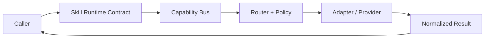

# Ginkgo Skill Runtime Contract

> Caller-agnostic execution contract for the existing Ginkgo Skill Atlas.
>
> This document does **not** create a second Atlas. It defines the stable runtime boundary used by callers while `SKILL_ATLAS.md` remains the lifecycle, governance, eval and promotion manual.

## Canonical runtime path



Supported callers include n8n/Callima, Hermes, OpenClaw, Sylvia and future agents. A caller depends on the **skill contract**, never on provider-specific URLs, credentials, SDK types or model IDs.

## Core invariant

```text
CALLER != SKILL != CAPABILITY != TOOL != PROVIDER
```

The caller selects a skill by purpose. The Capability Bus and Router resolve the implementation allowed by policy and evidence.

## Canonical lifecycle

New manifests expose exactly one caller-facing lifecycle field:

```text
FEATURE
→ PROTOTYPE
→ VALIDATED
→ INTEGRATED
→ PRODUCTION
```

Existing Atlas maturity codes remain valid as compatibility metadata:

| `lifecycle_status` | Compatible Atlas maturity | Meaning |
|---|---|---|
| `FEATURE` | `F0`, `F1/SPECIFIED` | candidate/specification; not routable as a trusted operational skill |
| `PROTOTYPE` | `F2` | implementation exists but validation is incomplete |
| `VALIDATED` | `F3`, `S1/SKILL` | reproducible evidence supports the contract; not necessarily integrated |
| `INTEGRATED` | `S2` | wired into the agentic ecosystem under policy |
| `PRODUCTION` | `S3` | operational use with observability and production policy |

`SPECIFIED` and `SKILL` are retained as internal/historical maturity detail, not additional caller-facing lifecycle stages.

**Nothing leaves `FEATURE` without evidence.** Evidence must identify what was tested, where it lives, and which promotion claim it supports.

## Request envelope — `ginkgo.skill-request.v1`

```yaml
schema: ginkgo.skill-request.v1
request_id: uuid-or-stable-id
skill_id: commerce.product.evaluate
input: {}
constraints:
  max_cost: null
  latency_class: normal
  privacy: default
context:
  caller: sylvia
  correlation_id: optional
  tenant_ref: optional
```

### Caller restrictions

Unless a skill explicitly declares otherwise, callers must not provide:

```yaml
forbidden_runtime_fields:
  - provider
  - tool
  - adapter
  - endpoint
  - credential
  - secret
  - model
  - command
  - shell_args
```

Those are Router/Policy concerns. This prevents n8n, Hermes, OpenClaw, Sylvia or another caller from coupling itself to a specific provider.

## Normalized result — `ginkgo.skill-result.v1`

```yaml
schema: ginkgo.skill-result.v1
request_id: same-as-request
skill_id: commerce.product.evaluate
status: success | partial | blocked | error
data: {}
error:
  code: null
  message: null
  retryable: false
provenance:
  provider: null
  tool: null
  adapter: null
  observed_at: null
  source_refs: []
policy:
  approval_required: false
  approval_state: not_required | pending | approved | denied
  fallback_used: false
metrics:
  duration_ms: null
  cost: null
```

Provider-specific payloads may be preserved behind provenance/audit boundaries, but the caller receives a normalized contract.

## Required manifest fields

Every new skill or feature contract must define:

```yaml
id: domain.object.action
version: 0.1.0
lifecycle_status: FEATURE
maturity: F1
level: L1
autonomy_level: A1
purpose: ...
capability: ...

use_when: []
avoid_when: []

inputs:
  required: []
  optional: []
  forbidden: []

outputs:
  contract: ginkgo.skill-result.v1
  data_contract: ...

permissions: {}
approval_required: false
execution_mode: autonomous | supervised | connector | human_assisted

preferred_tools: []
preferred_providers: []
fallbacks:
  policy: explicit
  order: []

validation:
  evidence: []
  blockers: []

promotion:
  allowed: false
  requires: []
```

## Permissions

Permissions describe what execution may actually touch, not what a provider theoretically supports. Marketplace skills should distinguish at least:

```yaml
permissions:
  external_network: true | false
  marketplace_read: []
  marketplace_write: []
  pii: none | redacted | restricted
  filesystem_write: none | audit_only | scoped
  shell: false
  secrets:
    read_refs: []
```

A read skill must not inherit write scopes merely because the same provider also exposes mutation endpoints.

## `approval_required`

`approval_required` governs **human/business approval for this skill execution**, not provider authentication.

External availability gates are separate:

```yaml
availability:
  routing_eligible: false
  live_execution: blocked
  external_gate: shopee_business_approval
```

Approval must never bypass an external gate, a disabled provider, missing evidence or a mutation policy.

## Router and fallback rules

1. Only implementations supported by the skill's lifecycle, provider validation status and policy are eligible.
2. Fallback is explicit and must preserve marketplace, permissions, privacy and output semantics.
3. Never silently cross from one marketplace to another.
4. Never silently escalate from read to write.
5. Never use a more expensive or less private fallback without policy evaluation.
6. If no eligible implementation exists, return a normalized blocked/error result such as `NO_VALIDATED_PROVIDER` or `PRE_APPROVAL_BLOCKED`.

## Evidence rules

Evidence can include tests, evals, PRs, reports, E2E runs, security reviews and live read-only validations. The claim must match the evidence:

- offline unit tests can support implementation correctness, not live-provider validation;
- credentials configured outside Git are not evidence by themselves;
- a single public snapshot can support a case study, not universal production readiness;
- an open PR may support `PROTOTYPE`, but promotion should not outrun the repository branch that contains the implementation;
- external marketplace approval is a hard gate when required.

## Commerce batch policy

For the first commerce batch:

- Amazon read skills remain `FEATURE` until a repository-backed adapter and reproducible read evidence exist.
- Shopee skills remain `FEATURE` / `PRE-APPROVAL` until Shopee approval and the first governed read-only validation are recorded.
- `commerce.product.evaluate` may be `PROTOTYPE` because deterministic implementation and tests exist, but it is advisory and not a publishing/purchasing authorization.
- Current evaluation policy is injected by the governed domain configuration, not chosen by callers: minimum multiplier `5x`, minimum operating margin `60%`, minimum contribution `R$30`.

## Promotion gate

A promotion PR must answer:

```yaml
promotion_evidence:
  contract_test: pass | fail | not_applicable
  happy_path: pass | fail | not_applicable
  invalid_input: pass | fail | not_applicable
  error_normalization: pass | fail | not_applicable
  timeout_retry: pass | fail | not_applicable
  permissions: pass | fail | not_applicable
  secret_scan: pass | fail | not_applicable
  observability: pass | fail | not_applicable
  e2e: pass | fail | not_applicable
  live_provider_read: pass | fail | not_applicable
  reviewer: required
```

No field may be promoted by inference. GitHub evidence is the source of truth.
