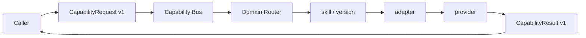
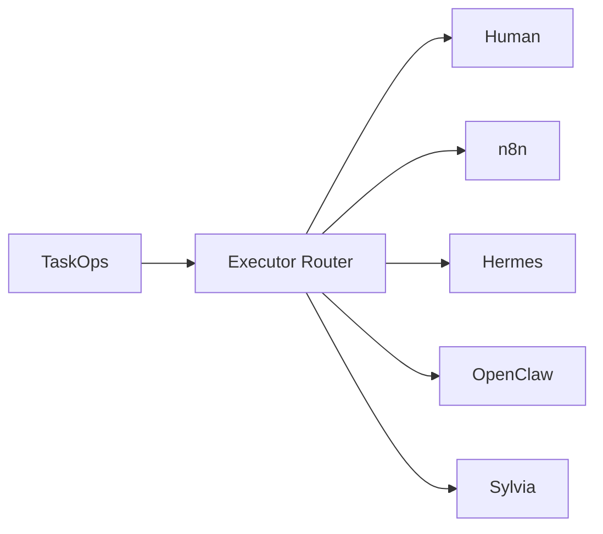

# Ginkgo Skill Runtime Contract

> P0-aligned runtime contract for the existing Ginkgo Skill Atlas.
>
> This document does **not** define or duplicate the core JSON Schemas. The canonical contracts are owned by `Ginkgo-Core/ai-stack` under `contracts/core/*`. `SKILL_ATLAS.md` remains the lifecycle, governance, eval and promotion manual for this repository.

## P0 source of truth

Canonical contracts:

- `Ginkgo-Core/ai-stack/contracts/core/capability-request.schema.json` — **CapabilityRequest v1**
- `Ginkgo-Core/ai-stack/contracts/core/capability-result.schema.json` — **CapabilityResult v1**
- `Ginkgo-Core/ai-stack/contracts/core/approval.schema.json` — Approval state machine
- `Ginkgo-Core/ai-stack/contracts/core/external-gate.schema.json` — External Gate state machine
- `Ginkgo-Core/ai-stack/contracts/core/evidence.schema.json` — execution/claim evidence
- `Ginkgo-Core/ai-stack/contracts/core/error.schema.json` — normalized errors

Architecture precedence for this runtime boundary follows the P0 freeze in `Ginkgo-Core/ai-stack#15`.

This repository references those contracts; it does not fork them.

## Canonical capability path



Operational executor selection is a separate path:



`Domain Router != Executor Router`.

The Domain Router resolves semantic implementation routing. The Executor Router assigns operational work. Neither absorbs the other's responsibility.

## Caller semantics

A caller expresses **capability intent**, not implementation choice.

```text
caller
  -> capability.name
  -> capability.contract_version
  -> input / constraints / governance context
```

The Domain Router resolves:

```text
capability
  -> skill_id
  -> skill_version
  -> adapter
  -> provider
```

The caller must never select `skill_id`, `skill_version`, adapter, raw endpoint, credential, secret or provider implementation. `constraints.allowed_providers`, when present in the canonical request, is an eligibility restriction/allowlist; it does not transfer final provider selection to the caller.

Public capability names are provider-agnostic. Provider identity belongs to internal bindings/adapters.

## CapabilityRequest v1

The authoritative shape is the P0 JSON Schema in `Ginkgo-Core/ai-stack/contracts/core/capability-request.schema.json`.

The following is a **non-authoritative field map** for Atlas authors:

```yaml
request_id: required
correlation_id: required
task_id: optional
execution_id: optional

caller:
  actor_id: required
  actor_type: required
  tenant_id: required
  workspace_id: required

capability:
  name: required
  contract_version: required

input: object

constraints:
  deadline: optional
  max_cost: optional
  data_classification: optional
  allowed_providers: optional
  fallback_policy: none | same_semantics_only

governance:
  approval_context: required
  external_gate_context: required

evidence:
  required: boolean

idempotency_key: required
```

Caller-facing examples in this repository must use `capability.name` and `capability.contract_version`; they must not use caller-selected `skill_id`.

## CapabilityResult v1

The authoritative shape is the P0 JSON Schema in `Ginkgo-Core/ai-stack/contracts/core/capability-result.schema.json`.

The following is a **non-authoritative field map** for Atlas authors:

```yaml
request_id: required
correlation_id: required
execution_id: required

capability:
  name: required
  contract_version: required

skill_id: router-resolved
skill_version: router-resolved
status: SUCCESS | PARTIAL | BLOCKED | ERROR
output: normalized capability output

routing:
  domain: internal audit/control metadata
  adapter_id: internal audit/control metadata
  provider: internal audit/control metadata
  fallback_used: boolean
  routing_reason: string

evidence_refs: []
cost_events: []
approval: {}
external_gates: []
error: null | normalized error
```

`routing.adapter_id` and `routing.provider` exist for internal audit/control. They are not caller choices and must not be exposed in an unprivileged caller projection.

## Legacy compatibility aliases

Historical draft envelopes may still appear in old documents or adapters:

- `ginkgo.skill-request.v1`
- `ginkgo.skill-result.v1`

They are **legacy compatibility aliases/adapters only**. They are not a source of truth and must not be used as the canonical shape for new manifests or callers.

Any compatibility adapter must translate:

```text
legacy request -> CapabilityRequest v1 -> Capability Bus
CapabilityResult v1 -> legacy result projection
```

A legacy adapter must not preserve caller-selected `skill_id` as routing authority. If an old request contains `skill_id`, it may be logged for migration diagnostics but routing is determined from the provider-agnostic capability contract.

## Canonical lifecycle

Caller-facing lifecycle:

```text
FEATURE
-> PROTOTYPE
-> VALIDATED
-> INTEGRATED
-> PRODUCTION
```

Existing Atlas maturity codes remain compatibility metadata:

| `lifecycle_status` | Compatible Atlas maturity | Meaning |
|---|---|---|
| `FEATURE` | `F0`, `F1/SPECIFIED` | candidate/specification; **never production-routable** |
| `PROTOTYPE` | `F2` | implementation exists but validation is incomplete |
| `VALIDATED` | `F3`, `S1/SKILL` | reproducible evidence supports the contract; not necessarily integrated |
| `INTEGRATED` | `S2` | wired into the ecosystem under policy |
| `PRODUCTION` | `S3` | operational use with observability and production policy |

`SPECIFIED` and `SKILL` remain historical/internal maturity detail, not additional caller-facing lifecycle stages.

**Nothing leaves `FEATURE` without evidence, and `FEATURE` never executes in production.**

## Required manifest semantics

New or migrated manifests should declare at least:

```yaml
id: internal-skill-or-binding-id
version: 0.1.0
lifecycle_status: FEATURE
maturity: F1
capability: provider-agnostic.public.capability

caller_contract:
  request: CapabilityRequest v1
  request_schema_ref: Ginkgo-Core/ai-stack/contracts/core/capability-request.schema.json
  result: CapabilityResult v1
  result_schema_ref: Ginkgo-Core/ai-stack/contracts/core/capability-result.schema.json

fallback_policy: none

approval:
  required: false
  status: NOT_REQUIRED

external_gates: []

routing:
  routing_eligible: false
  live_execution: blocked
```

Provider-specific manifests may contain internal adapter/provider binding metadata for audit and implementation resolution. That metadata is never caller-facing routing authority.

## Public naming vs implementation naming

Public capability names describe semantics:

```text
commerce.catalog.search
commerce.catalog.read
commerce.pricing.read
commerce.inventory.read
commerce.orders.read
commerce.product.normalize
commerce.product.evaluate
```

Provider-specific implementation IDs are internal bindings, for example:

```text
amazon-spapi.catalog.search
amazon-spapi.pricing.read
amazon-spapi.inventory.read
amazon-spapi.orders.read

shopee-open-api.catalog.read
shopee-open-api.orders.read
shopee-open-api.product.normalize
```

`commerce.product.evaluate` remains provider-neutral because it is deterministic domain logic rather than a marketplace adapter binding.

Historical IDs such as `commerce.amazon.*` and `commerce.shopee.*` may be retained only as explicit deprecated aliases. They must not be advertised as public capabilities.

## Approval

Approval is a human/business authorization contract separate from provider eligibility and External Gates.

Canonical states:

```text
NOT_REQUIRED
PENDING
APPROVED
REJECTED
EXPIRED
```

`denied` is not a canonical Approval state.

An Approval transition never mutates an External Gate. In particular:

```text
approval=APPROVED + external_gate=BLOCKED => BLOCKED
approval=APPROVED + external_gate=UNKNOWN => BLOCKED until the gate becomes CLEAR
```

## External Gates

External Gates use the separate P0 contract and state machine:

```text
CLEAR
BLOCKED
UNKNOWN
EXPIRED
```

A gate represents an external or deterministic precondition such as marketplace business approval, provider entitlement or legal availability.

For the current Shopee pre-approval freeze:

```yaml
external_gate:
  id: shopee_business_approval
  status: UNKNOWN
routing_eligible: false
live_execution: blocked
```

The current evidence records Business Approval as pending/not yet granted, so `UNKNOWN` is used rather than inventing a rejection. A human Approval cannot clear this gate.

## Fallback

Default:

```yaml
fallback_policy: none
```

The only generic opt-in policy permitted by P0 is:

```yaml
fallback_policy: same_semantics_only
```

`same_semantics_only` must preserve domain, semantic action, permission class, read/write behavior, data classification, lifecycle eligibility, External Gate eligibility and output semantics.

Never allowed:

- Amazon -> Shopee fallback;
- Shopee -> Amazon fallback;
- read -> write fallback;
- cross-domain fallback;
- `FEATURE` -> production routing;
- a fallback that changes capability semantics.

If no eligible route exists, fail closed with a normalized `CapabilityResult v1` blocked/error result.

## Evidence and Knowledge

**Evidence != Knowledge.**

Evidence proves an execution or promotion claim. Knowledge is a separately governed/promoted artifact. Test reports, CI runs, PRs and read-only live validations may support lifecycle claims but do not automatically become runtime Knowledge.

GitHub is the source of truth for contracts, architecture and promotion evidence in this repository.

Evidence claims must match what was actually proven:

- offline tests can support implementation correctness, not live-provider validation;
- configured credential names do not prove provider access;
- a green offline CI does not prove a live marketplace contract;
- an open Draft PR may support prototype evidence, but promotion must not outrun the branch/commit that contains the implementation;
- external marketplace approval remains a hard gate where required.

## Commerce P0 ceilings

For this batch:

- Amazon bindings remain `FEATURE`.
- Shopee bindings remain `FEATURE` / `PRE_APPROVAL`.
- `commerce.product.evaluate` remains `PROTOTYPE` / `F2`.
- no lifecycle promotion is inferred from offline tests.
- no marketplace mutation permission is introduced.

Current Shopee evidence source:

```text
Scale-Characters/amazon-ops#2
head bccfc0f5142f432f889158870c8f9e26e353fa65
GitHub Actions CI run #3 / 32169677496
Ruff: PASS
Shopee offline: 28 passed
General suite: 104 passed, 1 deselected
Windows/Linux diagnostic: 1 expected failure, explicit and non-blocking
mutations: OFF
live Shopee: OFF
credentials in CI: none
```

This evidence does **not** prove live-provider validation.

## `commerce.product.evaluate`

The evaluator remains deterministic, provider-neutral domain logic. Governed policy owns the current thresholds:

```yaml
minimum_multiplier: 5.0
minimum_operating_margin_pct: 60
minimum_contribution_brl: 30
caller_may_override: false
```

Its domain decision `APPROVED` means only that the economic evaluation gates passed. It is not the P0 human Approval contract and grants no authority to:

- publish;
- purchase;
- mutate pricing;
- mutate inventory;
- fulfill orders.

## Promotion gate

A promotion PR must carry reproducible GitHub evidence for the claim being promoted. No field or lifecycle state may be promoted by inference.

Minimum review dimensions include contract behavior, happy path, invalid input, error normalization, timeout/retry where applicable, permissions, secret handling, observability, E2E scope, live-provider scope and reviewer approval.
