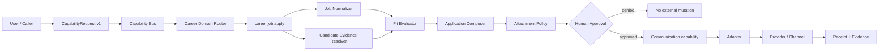

# FEATURE — `career.job.apply`

## Status

- **Lifecycle:** `SPECIFIED`
- **Maturity:** `F1`
- **Target level:** `L3 / Operational`
- **Target autonomy:** `A3 / supervised agentic`
- **Production eligible:** **NO**
- **Promotion allowed:** **NO**, until reproducible validation exists

This feature converts the manual pattern **job posting → evidence-backed fit analysis → tailored application → approval → submission → evidence** into a governed agentic workflow.

It intentionally remains in `features/` because the Skill Atlas forbids promotion from a successful manual case alone.

---

## Problem

Applying for a role is not just text generation. A reliable agent must coordinate six distinct concerns:

1. understand the vacancy and distinguish mandatory requirements from differentiators;
2. retrieve trustworthy candidate facts from approved sources;
3. identify strengths and hard gaps without hiding them;
4. construct a truthful positioning strategy;
5. select attachments using data minimization;
6. perform the external submission only after explicit human authorization.

A monolithic prompt can generate a convincing email, but it cannot by itself guarantee provenance, approval semantics, attachment safety, idempotency or audit evidence.

`career.job.apply` models the process as an operational skill candidate instead.

---

## Target architecture



The caller chooses the capability and business input. It never chooses provider, adapter, tool or model.

---

## Agentic stages

### 1. Job ingestion

Normalize the vacancy into:

- role title;
- company/context when available;
- responsibilities;
- mandatory requirements;
- preferred requirements;
- location/work model;
- application instructions;
- destination/recipient when supplied.

Every extracted item keeps provenance to the original vacancy.

### 2. Candidate evidence resolution

Build a candidate evidence map from authorized sources such as:

- resume;
- portfolio;
- GitHub;
- LinkedIn;
- user-asserted facts;
- approved personal context.

The agent may use a user assertion, but it must be marked as such unless independently supported.

### 3. Fit assessment

Create a requirement-by-requirement matrix.

Each item must be classified as one of:

- `SUPPORTED_MATCH`;
- `PARTIAL_MATCH`;
- `FORMAL_GAP`;
- `UNVERIFIED`;
- `NOT_APPLICABLE`.

Mandatory gaps are surfaced. They are never silently rewritten as strengths.

### 4. Positioning

Select the smallest set of evidence-backed strengths that best explains why the candidate is relevant to this specific role.

The composer should prefer concrete work and architecture examples over generic adjectives.

### 5. Draft generation

Generate:

- subject;
- primary application body;
- optional shorter version;
- optional follow-up recommendation.

The output must remain recruiter-readable and avoid keyword spam.

### 6. Attachment policy

Default allow:

- resume;
- portfolio;
- non-sensitive work samples.

Default deny:

- driver license;
- passport;
- national ID;
- banking documents;
- payment-card data;
- unrelated tax or medical documents.

The existence of a file is never sufficient reason to attach it.

### 7. Approval packet

Before any external mutation, present an immutable review packet containing:

- destination;
- subject;
- final body;
- exact attachments;
- identified mandatory gaps;
- notable unverified claims;
- expected external action.

Human approval is separate from external provider/channel gates.

### 8. Submission

After explicit approval, execute the communication/application capability through the routed adapter/provider.

No direct credentials, provider choice or tool choice appear in the public skill contract.

### 9. Evidence

Return:

- submission status;
- provider-independent receipt reference;
- timestamp;
- content digest;
- attachment digest/list;
- approval reference;
- normalized errors when applicable;
- optional follow-up plan.

---

## Trust model

### Candidate claims

The workflow follows one rule: **persuasion may optimize framing, never facts**.

Prohibited transformations include:

- unfinished degree → completed degree;
- technical reading ability → invented advanced fluency;
- founder/project work → fabricated employment history;
- prototype → fabricated production deployment;
- estimate → fabricated metric;
- planned certification → completed certification.

### Sensitive attachments

High-risk identity documents require a specific business need and a specific user authorization for that exact document. They cannot be selected automatically.

### Secrets

OAuth tokens, API keys and passwords belong to the adapter/provider boundary. They are never skill inputs and never appear in evidence logs.

---

## Approval invariant

```text
ANALYZE / DRAFT
    ↓
no approval required
    ↓
APPROVAL PACKET
    ↓
explicit human authorization
    ↓
EXTERNAL SUBMISSION
```

A draft may be created without approval because it does not deliver content externally. Sending, uploading or submitting always requires explicit authorization in v1.

---

## No-fallback invariant

There is no silent fallback from one external channel to another.

Example:

```text
email submission unavailable
!=
automatically apply through browser form
```

A different channel is a new governed execution path and must preserve the same semantics and approval state.

---

## Seed case

The initial observational case on 2026-08-21 demonstrated the intended UX:

```text
specific Generative AI vacancy
→ analyze requirements
→ compare against uploaded resume and known candidate evidence
→ expose formal gaps
→ produce tailored application
→ choose resume as relevant attachment
→ exclude an unnecessary driver-license document
→ user explicitly requests send
→ email is submitted
```

This is useful product evidence, but it is **not** sufficient validation under the Skill Atlas.

---

## Target dependencies

At F2, the implementation should resolve or define provider-neutral primitives for:

- candidate/document retrieval;
- optional public portfolio/GitHub retrieval;
- structured job normalization;
- email draft/send;
- browser-based application forms only as a separate validated path;
- audit/evidence persistence.

These dependencies must be routed capabilities rather than hardcoded provider names in the public contract.

---

## Promotion path

```text
F1 SPECIFIED   ← current
↓
F2 PROTOTYPE   runtime/workflow + contracts
↓
F3 VALIDATED   tests + security + ≥3 reproducible E2Es
↓
S1 SKILL       official manifest under skills/career/job/apply/
↓
S2 INTEGRATED  Capability Bus + Career Router + evidence
↓
S3 PRODUCTION  monitoring, evals, operational policy
```

The eventual S1 artifact should only be created after `PROMOTION_APPROVED: true`.
