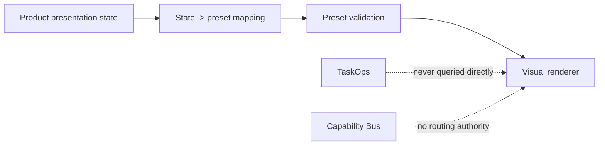

# Visual VFX — capability candidates

> Canonical lifecycle: **FEATURE**
>
> Compatibility maturity metadata: **F1 / SPECIFIED**.
>
> This feature is not a production skill and must not be selected by production routing until validation evidence exists.

Architecture authority: `Ginkgo-Core/ai-stack/architecture/visual/vfx-engine.md`.

## Purpose

Define provider-agnostic capability candidates for realtime browser VFX that can be used by Ginkgo products and agents without coupling callers to Three.js, GLSL or any specific renderer implementation.

The renderer is a presentation subsystem. It is not an Executor Router, Capability Bus, Domain Router, provider-selection layer or operational state authority.

## Candidate capabilities

### `visual.vfx.render`

Purpose: render a validated VFX preset into a browser-hosted visual surface.

Inputs:

```yaml
preset:
  schema_version: visual.vfx.preset.v1
surface:
  width: number
  height: number
presentation_state: optional string
```

Outputs:

```yaml
render_status: rendered | degraded | unavailable
quality_applied: low | balanced | high
telemetry:
  fps: optional number
  frame_time_ms: optional number
```

Risks:

- GPU overload;
- WebGL unavailable;
- resource leaks;
- inaccessible motion;
- host-page performance regression.

Candidate implementation: future `Ginkgo-Core/ginkgo-visual` browser renderer.

Autonomy ceiling while FEATURE: `A0`/design-time only.

---

### `visual.vfx.preset.create`

Purpose: convert a constrained creative intent into a schema-valid VFX preset.

Inputs:

```yaml
intent: string
constraints:
  quality: optional low | balanced | high
  motion_reduction: optional respect-user | reduced | full
  allowed_effects: optional list
```

Outputs:

```yaml
preset:
  schema_version: visual.vfx.preset.v1
  effect: allowlisted string
  parameters: bounded object
```

Rules:

- no arbitrary GLSL output in the production contract;
- no JavaScript generation path;
- effect IDs are allowlisted;
- all numeric values are bounded by schema;
- output must pass deterministic validation before rendering.

Risks:

- malformed presets;
- visually unsafe parameter combinations;
- prompt injection attempting to escape the preset schema.

Candidate executors: LLM/agent for intent translation + deterministic local validator.

Autonomy ceiling while FEATURE: `A0`.

---

### `visual.vfx.preset.transform`

Purpose: modify an existing preset while preserving its schema and safety boundaries.

Examples:

```text
"make it calmer"
"reduce particles by half"
"shift from electric to icy"
```

Inputs:

```yaml
preset: visual.vfx.preset.v1
instruction: string
```

Outputs:

```yaml
preset: visual.vfx.preset.v1
changes: list
```

Invariant: transformation cannot expand the allowed schema or inject shader source.

Autonomy ceiling while FEATURE: `A0`.

---

### `visual.vfx.background.render`

Purpose: render a decorative procedural background for a web surface using a validated preset.

Primary consumers:

- Ginkgo institutional landing pages;
- product hero sections;
- optional decorative dashboard surfaces.

Non-goal: encode business-critical state.

Accessibility requirement: decorative by default and independently removable without loss of page meaning.

Autonomy ceiling while FEATURE: `A0`.

---

### `visual.vfx.agent-state.render`

Purpose: map a normalized agent presentation state to a visual preset and render it.

Candidate normalized states:

```text
idle
thinking
executing
waiting
success
error
```

The capability never reads TaskOps, CRM or runtime state directly. A product adapter supplies the presentation state.



Autonomy ceiling while FEATURE: `A0`.

## Proposed preset contract

```yaml
schema_version: visual.vfx.preset.v1
effect: energy_aura
parameters:
  particle_density: 0.72
  noise_scale: 1.8
  distortion: 0.31
  speed: 0.84
quality: balanced
motion_reduction: respect-user
```

First allowlisted effect for prototype validation:

```text
energy_aura
```

Do not add multiple effects before the resource lifecycle, performance and accessibility gates pass for one effect.

## Implementation boundary

Preferred implementation stack:

```text
TypeScript
React bindings
Three.js
hand-written GLSL
GPU/instanced particles where justified
schema validator
telemetry
```

Three.js and GLSL are implementation details, not public capability names.

## Upstream reference

Reference project:

```text
achrefelouafi/LinearAbilityExtThreeJS
Elemental Sandbox
Three.js + Vite + hand-written GLSL
MIT upstream reference
```

Any code adaptation requires pinned upstream commit provenance and license preservation before promotion.

## Promotion gates

To move beyond FEATURE, evidence must demonstrate:

- one reusable `energy_aura` implementation;
- preset validation tests;
- bounded parameter handling;
- mount/unmount resource teardown;
- reduced-motion path;
- graceful WebGL failure;
- benchmark evidence on desktop and Android-class browser;
- one real Ginkgo web integration;
- upstream provenance for copied/adapted source;
- no architecture boundary violation.

Promotion remains explicit:

```text
FEATURE
-> PROTOTYPE
-> VALIDATED
-> INTEGRATED
-> PRODUCTION
```

Until then:

```text
FEATURE != PRODUCTION
```
