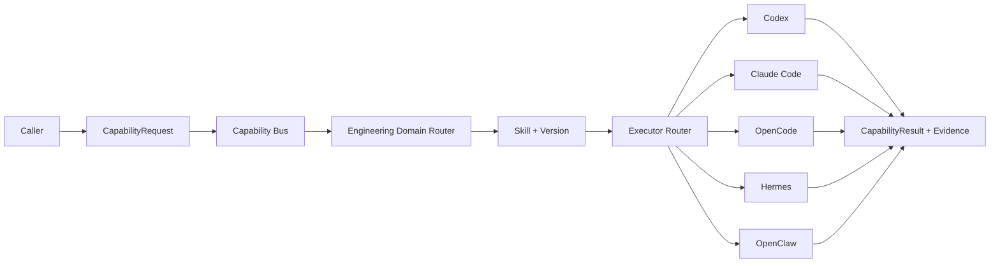

# Ginkgo Agentic Engineering Suite

Status: **FEATURE / methodology specification**

This suite converts external engineering-agent patterns into caller-agnostic Ginkgo skills. The sources are methodological references, not runtime authorities. No external repository is allowed to bypass the Capability Bus, Domain Router, policy layer, approval gates, executor routing or evidence requirements.

## Canonical boundary



The public capability describes **what engineering outcome is requested**. The caller does not choose the executor, model, provider, shell command, browser tool or external skill pack.

## Proposed capability family

| Capability | Intent | Mutation posture | Minimum evidence |
|---|---|---|---|
| `engineering.plan` | produce an implementation plan from a bounded problem | read-only | assumptions, scope, dependencies, test plan |
| `engineering.architecture.review` | evaluate boundaries, contracts and failure modes | read-only | findings tied to files/contracts |
| `engineering.code.review` | inspect a concrete change set for defects | read-only by default | changed-file findings and severity |
| `engineering.security.audit` | inspect security posture and abuse paths | read-only | threat model, findings, remediation |
| `engineering.qa` | validate user-visible or API behavior | read-only by default | test cases, observed results, artifacts |
| `engineering.investigate` | perform root-cause investigation before proposing a fix | read-only until a separate mutation request | hypotheses, tests, eliminated causes, root cause |
| `engineering.release.validate` | determine whether a change is safe to release | read-only | CI, tests, migration, rollback and risk evidence |
| `engineering.retro` | synthesize engineering outcomes and recurring failure patterns | read-only | sourced observations and actions |
| `engineering.freeze` | define or verify a protected architecture/release freeze | metadata mutation only when separately authorized | frozen contracts, invariants, head SHA |
| `engineering.devex.review` | evaluate developer onboarding and tool ergonomics | read-only | reproduced flow, friction points, measurements |

## Pattern sources

### ECC

Use as a source for:

- research-first development;
- reusable engineering instincts;
- security and memory patterns;
- multi-host agent harness conventions;
- progressive skill composition.

Do **not** treat ECC as a Ginkgo provider. Its useful unit is the method/pattern that can be re-expressed as a Ginkgo skill contract.

Source: https://github.com/affaan-m/ECC

### gstack

Use as a source for a disciplined engineering lifecycle:

`Think -> Plan -> Build -> Review -> Test -> Ship -> Reflect`

Relevant patterns to internalize:

- founder/product challenge before implementation;
- explicit architecture review;
- QA against real behavior;
- release validation;
- security review;
- investigation before repair;
- retrospective learning;
- browser-assisted validation.

Do **not** import the external command namespace as the public Ginkgo API. `/review`, `/qa`, `/ship` and similar commands are host-specific affordances; Ginkgo exposes stable capability names instead.

Source: https://github.com/garrytan/gstack

## Mutation separation

A read/review capability must not silently mutate code. If implementation is desired, TaskOps must create or authorize a separate bounded mutation task.

Example:

```text
engineering.code.review
  -> finding: race condition
  -> CapabilityResult(recommendation)

TaskOps / human approval
  -> separate implementation task
  -> executor selected by Executor Router
  -> evidence + diff + tests
```

This prevents a reviewer from becoming its own unreviewed patch pipeline.

## Executor policy

Executor selection is internal policy. Candidate executors may include Codex, Claude Code, OpenCode, Hermes, OpenClaw or future runtimes. Pi is an evaluation candidate, not an approved production executor.

Executor eligibility must consider:

- repository permissions;
- network permissions;
- filesystem boundary;
- credential isolation;
- required host tools;
- sandbox availability;
- expected cost;
- model/tool compatibility;
- requested autonomy level.

## Required result envelope

Every engineering capability should return a normalized `CapabilityResult` with domain data plus evidence.

Minimum engineering evidence fields:

```yaml
evidence:
  repository_ref: owner/repo
  base_ref: string | null
  head_ref: string | null
  files_inspected: []
  commands_or_checks: []
  external_sources: []
  findings: []
  tests:
    executed: []
    passed: []
    failed: []
    skipped: []
  mutations_performed: false
```

## Safety invariants

1. No direct secret exposure to a caller or engineering skill.
2. No automatic merge.
3. No automatic production deployment.
4. No hidden broadening from one repo to unrelated repos.
5. No filesystem or network access beyond the task policy.
6. Review and implementation are different intents.
7. Evidence must describe what was actually inspected or executed.
8. A methodology source never becomes an implicit provider binding.
9. Host-specific commands remain implementation details.
10. Promotion beyond FEATURE requires repository-backed validation.

## Promotion path

```text
FEATURE
  -> PROTOTYPE: one concrete implementation of each selected skill
  -> VALIDATED: deterministic tests + bounded real-repo trials
  -> INTEGRATED: Capability Bus + Domain Router + Executor Router wired
  -> PRODUCTION: policy, sandbox, telemetry and release evidence complete
```

## Initial implementation order

P0:

1. `engineering.plan`
2. `engineering.code.review`
3. `engineering.investigate`
4. `engineering.qa`
5. `engineering.security.audit`
6. `engineering.release.validate`

P1:

7. `engineering.architecture.review`
8. `engineering.devex.review`
9. `engineering.freeze`
10. `engineering.retro`

No capability in this document is routing-eligible merely because it is documented here.
