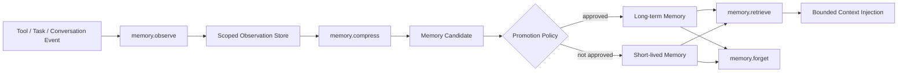

# Ginkgo Memory Continuity

Status: **FEATURE / architecture specification**

This document defines a provider-agnostic memory capability family inspired by persistent-session systems such as `thedotmack/claude-mem`. The objective is not to bind Ginkgo to Claude-specific hooks. The objective is to capture, compress, promote, retrieve and forget scoped observations under identity, provenance and retention policy.

## Capability family

- `memory.observe`
- `memory.compress`
- `memory.retrieve`
- `memory.promote`
- `memory.forget`
- `memory.timeline.read`

## Canonical lifecycle



## Scope model

Every memory record must be scoped. Global memory is not the default.

```yaml
scope:
  tenant_id: required
  identity_id: required
  project_id: optional
  repository_ref: optional
  task_id: optional
  conversation_id: optional
  agent_id: optional
```

Retrieval must never broaden scope merely because semantic similarity is high.

## Memory record

```yaml
memory_record:
  id: string
  created_at: timestamp
  observed_at: timestamp
  scope: object
  kind: observation | summary | decision | preference | fact | procedure | incident
  content: object|string
  provenance:
    source_type: conversation | tool | repository | document | external_api | human
    source_ref: string
    evidence_refs: []
  classification:
    sensitivity: public | internal | confidential | restricted
    pii: none | possible | confirmed
  retention:
    expires_at: timestamp|null
    policy_id: string
  confidence:
    score: number|null
    basis: observed | inferred | human_confirmed
  promotion:
    state: candidate | promoted | rejected
    reason: string|null
```

## Semantics

### `memory.observe`

Capture an event or observation with provenance. Observation is not promotion. Raw tool output should not automatically become durable memory.

### `memory.compress`

Reduce a bounded set of observations into a summary while preserving references back to the source evidence. Compression may reduce tokens; it must not erase provenance.

### `memory.retrieve`

Return the smallest useful set of scoped memories for the request. Retrieval ranking may combine recency, semantic similarity, explicit relationships, confidence and promotion state.

### `memory.promote`

Move a candidate into durable memory only when policy allows it. Promotion criteria should include repeat usefulness, explicit user confirmation, durable project decisions or verified facts.

### `memory.forget`

Delete or tombstone memories according to policy and propagate invalidation to indexes/caches. Forget must be a first-class capability, not an administrative afterthought.

### `memory.timeline.read`

Provide a chronological, evidence-linked view of memory creation, compression, promotion and invalidation for debugging and audit.

## Progressive disclosure

Context injection should be layered:

1. retrieve compact index entries;
2. expand only relevant summaries;
3. fetch raw observations only when necessary;
4. expose provenance with the returned memory.

This avoids the failure mode where "memory" becomes a permanent token landfill.

## Required controls

- tenant and identity isolation;
- sensitivity classification;
- retention TTL;
- explicit deletion;
- source provenance;
- inference tagging;
- human-confirmed promotion path;
- no secret persistence by default;
- no cross-project retrieval without policy;
- audit trail for promotion/deletion.

## Storage is not the capability

Redis, Postgres, pgvector, Qdrant, graph stores or specialized memory products may back the implementation. They are provider/storage choices behind adapters, not public memory capabilities.

Suggested hybrid topology:

```text
recent observations  -> Redis / short-term store
canonical history    -> Postgres
semantic retrieval   -> vector index
relationships        -> knowledge graph
artifacts/evidence   -> object/file store
```

## Source pattern

`thedotmack/claude-mem` is useful as a reference for automatic observation capture, semantic compression, progressive retrieval and session continuity. Claude-specific install hooks and command surfaces are not adopted as the Ginkgo contract.

Source: https://github.com/thedotmack/claude-mem

## Validation gates

Before promotion from FEATURE:

- scope-isolation tests;
- secret/credential persistence tests;
- deterministic forget/invalidation tests;
- provenance retention tests after compression;
- retrieval precision tests;
- cross-tenant negative tests;
- promotion-policy tests;
- bounded token-cost measurements;
- one governed multi-session E2E with evidence.

No runtime binding is declared by this document.
